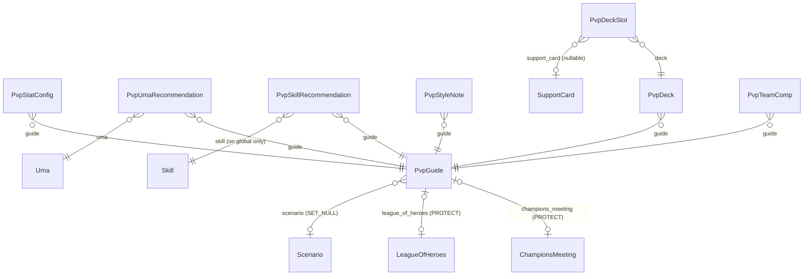

# Data Model

Entity-relationship overview for the `calculatorapi` app. All models live in `calculatorapi/models/`, one file per entity.

For the complete diagram, paste [database-schema.dbml](database-schema.dbml) into
[dbdiagram.io](https://dbdiagram.io). The DBML snapshot includes all 35 application
models, 3 automatic join tables, and 7 framework tables, with all 345 columns and
47 foreign-key relationships as of 2026-09-13. It uses PostgreSQL types and documents
Django defaults, deletion behavior, and partial unique indexes in notes. Update the
snapshot when models change; the Mermaid diagram below is a selected overview.

---

## ERD

```mermaid
erDiagram
    CustomUser {
        int id PK
        string username
        string display_name
        string email
        int current_carat
        int current_paid_carat
        int uma_ticket
        int support_ticket
        bool daily_carat
        bool training_pass
        int sr_shards
        int sr_crystals
        int ssr_shards
        int ssr_crystals
        int club_rank_id FK
        int team_trials_rank_id FK
        int champions_meeting_rank_id FK
        int league_of_heroes_rank_id FK
    }

    ClubRank {
        int id PK
        string name
        int income_amount
    }

    TeamTrialsRank {
        int id PK
        string name
        int income_amount
    }

    ChampionsMeetingRank {
        int id PK
        string name
        int income_amount
    }

    LeagueOfHeroesRank {
        int id PK
        string name
        int income_amount
    }

    BannerTimeline {
        int id PK
        string name
        datetime jp_start_date "nullable"
        datetime jp_end_date "nullable"
        datetime global_start_date "nullable; set when confirmed"
        datetime global_end_date "nullable; set when confirmed"
        int schedule_offset_days "days to push this and every later date forward"
        string image
    }

    BannerUma {
        int id PK
        int banner_timeline_id FK
        string name
        int free_pulls
        bool is_recommended "editorial; presentation only"
        int rate_up_picks "select banners only; null = every listed card is a rate-up"
        string admin_comments
    }

    BannerSupport {
        int id PK
        int banner_timeline_id FK
        string name
        int free_pulls
        bool is_recommended "editorial; presentation only"
        int rate_up_picks "select banners only; null = every listed card is a rate-up"
        string admin_comments
    }

    Uma {
        int id PK
        string name
        int game_id "unique, nullable; the game's card id, e.g. 102001 = character 1020 outfit 01. The join key for imported game data; the image filename starts with it"
        string image
        string image_borderless "the same art without the rarity border; umas_borderless/ in the Space; nothing renders it yet"
        string admin_comments
        string purpose "PUBLIC, max 100, never null; the Timeline tile's hover overlay"
        bool is_time_limited
        string title "IMPORTED from here down (import_game_data overwrites): the outfit's [Title]"
        int rarity "initial stars 1..3; the selector ★ gate reads it via the is_three_star property, null = ★3"
        int running_style "1 front 2 pace 3 late 4 end"
        int apt_turf "ten apt_* grades on the game's 1..8 scale (G..S): turf dirt short mile medium long front pace late end"
        int base_speed "five base_* stats at the initial star count"
        int growth_speed "five growth_* bonuses in percent"
    }

    Skill {
        int id PK
        int game_id "unique; the game's skill id"
        string name "global English"
        string description "the game's text, shown by default"
        string description_detailed "fan translation with numbers; from gametora, optional"
        int rarity "1 white 2 gold 3/4 the two halves of a star-1/2 unique 5 unique 6 evolved (none yet)"
        int group_id "white (o, and some groups a double-o), gold and x versions of one effect share it"
        int tier "group_rate: -1 penalty, 1 first, 2 double-o white or gold, 3 gold above a double-o"
        int icon_id "one of 63 generic icons"
        int cost "skill points; null for uniques"
        string precondition "raw game string"
        string condition "raw game string, for a later parser"
        int evolves_from FK "self, nullable; empty until global has evolution"
        string image "skills/<icon_id>.png, set by link_skill_images"
        string admin_comments
    }

    UmaSkill {
        int id PK
        int uma FK
        int skill FK
        string source "unique | innate | awakening | evolved"
        int level "awakening rank 2..5, or the star a unique applies from; null for innate"
        string notes
    }

    SupportCardSkill {
        int id PK
        int support_card FK
        int skill FK
        string source "hint (game data) | event (gametora)"
        string notes
    }

    SupportCard {
        int id PK
        string name
        int game_id "unique, nullable; anchors image to the DO Space file. ALSO ENCODES RARITY: 1xxxx R, 2xxxx SR, 3xxxx SSR — banners may only link 3xxxx"
        string card_type "IMPORTED: speed stamina power guts wit friend group; blank until imported"
        int rarity "1 R 2 SR 3 SSR; IMPORTED, else the first digit of game_id on save"
        int character_id "IMPORTED: the game's character id, a number not a FK"
        string title "IMPORTED: the card's [Title]"
        json group_members "IMPORTED: a group card's umas by name (support_card_group); [] for every other card"
        string image
        string admin_comments
        string purpose "PUBLIC, max 100, never null; the Timeline tile's hover overlay"
    }

    UmasOnUmaBanner {
        int id PK
        int banner_uma_id FK
        int uma_id FK
        string recommendation
    }

    SupportsOnSupportBanner {
        int id PK
        int banner_support_id FK
        int support_card_id FK
        string recommendation
    }

    Plan {
        int id PK
        int user_id FK
        string public_id UK "8 letters/digits: the share link"
        string name
        bool is_active "one per user"
        int income_profile_id FK "nullable: null = the account's stats"
        bool is_shared "default false: the link answers"
        bool share_stats "default false"
        bool share_notes "default false"
        int copy_count "copies taken through the link"
        datetime created_at
        datetime updated_at
    }

    IncomeProfile {
        int id PK
        int user_id FK
        int current_carat "the same 22 stat columns as CustomUser"
        int club_rank_id FK
        datetime created_at
        datetime updated_at
    }

    UserPlannedBanner {
        int id PK
        int plan_id FK "the owner"
        int user_id FK "transitional, dropped in release 2"
        int banner_uma_id FK
        int banner_support_id FK
        int banner_step_up_id FK
        int number_of_pulls "steps on a step-up row"
    }

    BannerStepUp {
        int id PK
        int banner_timeline_id FK
        int anniversary_event_id FK
        string name
        string card_type "uma | support"
        int banner_count
        string image
        int order
    }

    GameEvent {
        int id PK
        string name
        string image
        int banner_timeline_id FK "nullable"
        int carat_amount
        int carats_throughout
        int support_ticket_amount
        int uma_ticket_amount
        int sr_shard_amount
        int sr_crystal_amount
        int ssr_shard_amount
        int ssr_crystal_amount
    }

    Scenario {
        int id PK
        string name
        string image "nullable; art often lands after the row"
        int banner_timeline_id FK "nullable; supplies the START only"
    }

    DailyLegendRaceRelease {
        int id PK
        string name
        string image "nullable"
        int banner_timeline_id FK "nullable; supplies the START only"
        int offset_days "signed; added to that start"
    }

    DailyLegendRaceUma {
        int id PK
        int release_id FK
        int uma_id FK "UNIQUE: one release per uma"
    }

    ChangelogEntry {
        int id PK
        string title
        string version
        date date
        string key "nullable unique; set = owned by changelog.yaml"
    }

    ChangelogChange {
        int id PK
        int entry_id FK
        string category
        string text
        int order
    }

    ChampionsMeeting {
        int id PK
        string name
        int cm_number
        datetime jp_start_date "nullable"
        datetime jp_end_date "nullable"
        datetime global_start_date "nullable; set when confirmed"
        datetime global_end_date "nullable; set when confirmed"
        int schedule_offset_days "days to push this and every later date forward"
        string image
        string track
        string surface_type
        string distance
        string length
        string track_condition
        string season
        string weather
        string direction
        int speed_recommendation "unused; drops with the team builder"
        int stamina_recommendation "unused"
        int power_recommendation "unused"
        int guts_recommendation "unused"
        int wit_recommendation "unused"
    }

    LeagueOfHeroes {
        int id PK
        int loh_number
        string name
        datetime jp_start_date "nullable"
        datetime jp_end_date "nullable"
        datetime global_start_date "nullable; set when confirmed"
        datetime global_end_date "nullable; set when confirmed"
        int schedule_offset_days "days to push this and every later date forward"
        string image
        string track
        string surface_type
        string distance
        string length
        string track_condition
        string season
        string weather
        string direction
        int speed_recommendation "unused; drops with the team builder"
        int stamina_recommendation "unused"
        int power_recommendation "unused"
        int guts_recommendation "unused"
        int wit_recommendation "unused"
    }

    UserOshi }o--|| CustomUser : "user"
    UserOshi }o--|| Uma : "uma"
    CustomUser }o--|| ClubRank : "club_rank"
    CustomUser }o--|| TeamTrialsRank : "team_trials_rank"
    CustomUser }o--|| ChampionsMeetingRank : "champions_meeting_rank"
    CustomUser }o--|| LeagueOfHeroesRank : "league_of_heroes_rank"

    BannerUma }o--|| BannerTimeline : "banner_timeline"
    BannerSupport }o--|| BannerTimeline : "banner_timeline"

    UmasOnUmaBanner }o--|| BannerUma : "banner_uma"
    UmasOnUmaBanner }o--|| Uma : "uma"

    SupportsOnSupportBanner }o--|| BannerSupport : "banner_support"
    SupportsOnSupportBanner }o--|| SupportCard : "support_card"

    Plan }o--|| CustomUser : "user"
    Plan }o--o| IncomeProfile : "income_profile"
    IncomeProfile }o--|| CustomUser : "user"
    UserPlannedBanner }o--|| Plan : "plan"
    UserPlannedBanner }o--|| CustomUser : "user (transitional)"
    UserPlannedBanner }o--o| BannerUma : "banner_uma"
    UserPlannedBanner }o--o| BannerSupport : "banner_support"
    UserPlannedBanner }o--o| BannerStepUp : "banner_step_up"
    BannerStepUp }o--|| BannerTimeline : "banner_timeline"
    BannerStepUp }o--|| AnniversaryEvent : "anniversary_event"

    GameEvent }o--o| BannerTimeline : "banner_timeline"
    Scenario }o--o| BannerTimeline : "banner_timeline"
    DailyLegendRaceRelease }o--o| BannerTimeline : "banner_timeline"
    DailyLegendRaceUma }o--|| DailyLegendRaceRelease : "release"
    DailyLegendRaceUma |o--|| Uma : "uma"
    ChangelogChange }o--|| ChangelogEntry : "entry"

    AnniversaryEventBanner }o--|| AnniversaryEvent : "anniversary_event"
    AnniversaryEventBanner }o--|| BannerTimeline : "banner_timeline"
    AnniversaryEventProduct }o--|| AnniversaryEvent : "anniversary_event"
    UserPlannedPurchase }o--|| CustomUser : "user"
    UserPlannedPurchase }o--o| IncomeProfile : "income_profile"
    UserPlannedPurchase }o--|| AnniversaryEventProduct : "product"
    UserPlannedPurchase }o--o| Uma : "target_uma"
    UserPlannedPurchase }o--o| SupportCard : "target_support"
```



---

## Key Constraints and Design Notes

### `CustomUser.display_name` — a preference beside the handle

The generated `user_xxxxxx` username is the row's identity (the admin, every
`__str__`) and nothing can change it. Since 2026-09-13 a preference sits
**beside** it, written only by `PATCH /account`: `display_name`,
`CharField(32, blank=True, default="")`. **Unique, ignoring case, among
non-blank names** (`unique_display_name_ci`: `Lower("display_name")` with a
partial condition, so the many blank rows do not collide). Decided 2026-09-13
because display names will be visible to other users through future features,
so nobody may take a name another account goes by; the serializer also refuses
a name equal to any account's *handle*, which would impersonate it. The
serializer's pre-check gives the friendly 400 ("That name is taken."), the
constraint is the backstop for a race, and the view maps that `IntegrityError`
to the same 400. Migration `0057` blanks later duplicates before adding the
constraint (insurance for local databases; prod never held a name before it).
Personal data (a chosen name is), so `purge_user_pii` blanks it. Public in ONE place: beside
a gallery post or comment its owner made, through `public_identity.poster_block` (posting is
the opt-in; see "The gallery" below). Blanking it is refused while the person has a post up.

→ [auth-and-privacy.md](auth-and-privacy.md) for why this is not a profile
attribute, and [api-reference.md](api-reference.md) for the route.

### `CustomUser.early_access` — the owner's grant, not a pledge

A plain boolean (`0093`, 2026-10-15), ticked in the admin and nowhere else:
`PATCH /account`'s serializer field list is the whitelist and does not carry it.
It is the **third way into `benefits.early_access_for`**, beside a live pledge
and `is_staff`, and it opens ONLY that: not the oshi ladder, not the gallery
look, not `ad_free`. It exists so a tester or a friend can
try features still in early access without being made staff, which used to be
the habit: staff can sign in to the admin, bypass every supporter ladder, and
are excluded from analytics. No end date: revoking it is unticking it, and the
admin history says who did what when (the two bulk actions on the user
changelist log through `log_change` for the same reason). Not personal data, so
`purge_user_pii` leaves it alone.

### `UserOshi` — favourite umas, the first of which is the picture

The umas a person picked as favourites ("oshis" in the code and on the wire,
"your favorite uma musume" on screen), one row each:
`user` (FK, CASCADE, `related_name="oshis"`), `uma` (FK, **CASCADE**), `position`
(0-based). Unique on `(user, position)` and on `(user, uma)`. **The first one is
their picture** in the navbar and on the account page. Every account holds one
(`benefits.FREE_OSHI_SLOTS`); Patreon supporters hold more by tier, so the perk
is the *extra slots*. (Until 2026-10-07 the free count was 0 and the picture
itself was the perk.) `OSHI_SLOT_CAP = 7` is the table's ceiling and equals the
top rung of `benefits.OSHI_SLOT_LADDER` (asserted at import).

- **Written only by `PATCH /account`**, which replaces the whole list and
  renumbers from 0 inside one transaction, so "the first" is always position 0
  among the rows that exist.
- **Entitlement is not stored here.** How many rows the account covers is
  `benefits.oshi_slots(user)` (1 free; 3 / 5 / 7 by tier, the free slot plus
  2, 4 or 6), derived per request like every
  other benefit — except staff, who get `OSHI_SLOT_CAP` regardless of tier
  (`oshi_slots_for(supporter, is_staff=...)`). That bypass reads `is_staff`,
  CustomUser's own field, so it adds no second copy of Patreon entitlement; it
  only unlocks the slot count, `supporter`/`is_supporter` in the `/account`
  response is untouched. **A lapse or downgrade keeps every row**: `GET /account` lists
  them all, shows the picture while `oshi_slots >= 1` (which, since the free
  slot, every signed-in account clears, so a lapsed supporter keeps their
  picture), and `PATCH` refuses only a list that *adds* past the count — a
  subset of what is already held may always be kept, reordered or trimmed.
- **CASCADE on the uma, not SET_NULL**: a slot with no uma is nothing, and the
  list will one day be shown publicly, where a dangling slot would be a blank
  tile. The remaining rows keep their positions; the view reads "first by
  position", so a gap is harmless.
- Only a **pickable** uma may be *added*: `Uma.pickable()` is one queryset for
  both `GET /umas` (what the picker lists) and the `PATCH` check, and means
  *with an image* and *not the `(All)` placeholder* (`Uma.ALL_PLACEHOLDER_NAME`,
  exact match). **Costume variants** (`Uma.is_costume_variant`: a `(` in the
  name, `Special Week (Summer)`) are listed for everyone but may be *added*
  only by a supporter on any paid tier or by staff (`benefits.oshi_variants`,
  sent as `oshi_variants` on `/account` so the picker locks the tiles). Owner's
  call, 2026-10-07. Both checks are on what a save **adds**, like the slot
  check: a held variant survives a lapse and may still be kept or reordered.
  If an editor clears an image later the row
  stays, its `image` is `""` on the wire, and the picture falls through to the
  next oshi rather than to a broken tile.
- **Not personal data.** The site's own art; `purge_user_pii` leaves it. Decided
  2026-09-13 that oshis **will** appear publicly in a future feature, so the table
  is built to be joined from the supporter side; that route must go through
  `PatreonSupporter.linked_user`, honour `is_public`, and never carry the display
  name or handle.
- Admin: a read-only inline (removal allowed) on the user page. Not editable
  there because the entitlement check lives in the serializer.

### `CalculationConstants` — the projection's tunables

A singleton (always `pk=1`, `save()` pins it, `delete()` is refused) holding every
flat rate and schedule the carat projection uses. Read it with `.load()`, which
creates it with defaults on first access so a fresh database starts correctly
calibrated. Deliberately **not cached**: production runs several worker
processes, so an edit saved by one would not invalidate a local cache held by the
others and the site would serve two different sets of constants depending on
which worker answered.

It also owns `prediction_factor` and `game_event_end_buffer_days`, which used to
be module constants in `predictions.py` *and* duplicated in the frontend's
`gameConstants.ts` with a comment on each warning they be kept in sync by hand.
`predictions.py` keeps its DB-free purity: the pure functions take both as
parameters defaulting to the module constants, and only the ORM wrappers read the
model.

### The income ledger

`calculatorapi/ledger.py` assembles a flat, date-sorted row per reward instant
from `GameEvent`, `ChampionsMeeting` and `LeagueOfHeroes`, served as
`income_ledger`. It is built from the querysets and effective-date maps
`/calculator-data` already has in hand — no extra queries, no model of its own.

It computes **no income**: it places rows on a calendar and nothing more, which
is the one narrow exception to this project's "backend carries no projection
math" rule. Race rows carry no amounts (the payout depends on the user's rank,
which only the client knows), and no row is gated on "today" — the ledger is a
set of dated facts, past ones included, so that the client's single `today`
anchor governs every income source uniformly.

Placing a row is a judgement, though, and `RACE_REWARD_LEAD_TIME` is where that
shows. A Champions Meeting's finals settle and pay out **24 hours before** its
listed end, so its ledger row is dated `end_date - 24h` while its timeline card
still shows the real window. League of Heroes carries the same lead time since 2026-10-29 (its last day pays 24 hours
before its end too); both kinds stay listed so a future divergence reads as
deliberate. Because the ledger owns this, every consumer inherits it: the banner
rows, the income tiles, and the uncap-crystals panel (which reads race payout
instants from `income_ledger`, not from `champions_meeting_data`, for exactly
this reason).

### `Plan` — a named list of planned banners, and nothing else

An account holds up to `PLAN_CAP` (5) plans and the calculator opens on the active one.
`UserPlannedBanner.plan` is what a row belongs to; the row's owner is `plan.user`.

**A plan holds choices. The account holds facts.** That line decides what goes where:

| Data | Lives on | Why |
|---|---|---|
| Planned banner rows (`number_of_pulls`, `reserved_copies`, `note`, `primary_card`, `second_card`, `primary_target`, the row options) | `Plan` | the choices |
| Which of the owner's stats blocks to read (`income_profile`, nullable) | `Plan` | a pointer, not a fact; dropped when a copy changes owner |
| Its share link and what a copy carries (`public_id`, `is_shared`, `share_stats`, `share_notes`, `copy_count`) | `Plan` | about the plan, not the person; a copy starts with all five at their defaults |
| Carats, tickets, selector tickets, shards, crystals, ranks | `CustomUser`, or an `IncomeProfile` the account owns | facts about the person (or about their other game account) |
| The income toggles | same row as the balances | income side |
| `UserPlannedPurchase` | the same stats block as the balances (`income_profile`, nullable) | money the person spends; it feeds income, so it follows the income it feeds |
| `UserStepUpSelection` | the account | already keyed to the banner, and changes no rate (its pick only dates a step-up row's reserved copies) |

So the same plan projected for two people gives two different answers, which is the point.
Worked example: Alice (80,000 carats, top ranks) and Bob (12,000 carats, middling ranks)
both hold a plan that says "Kitasan, 200 pulls". Alice sees it comfortably funded. Bob sees
a shortfall. Nothing on the plan differs; everything that differs is on their accounts.

That portability is deliberate. A player can share a plan and another player can take a
copy of it (next section but one, "Share links"), and that is `plans.copy_plan()` plus a
visibility rule. A plan that never
held anything about its author needs no stripping when it is copied and cannot leak what
someone holds or spends. **Do not add a field to `Plan` that describes the person.**
`reserved_copies` passes that test: only the count is stored, and which ticket or crystal
pays for each copy is derived on render from the viewer's own balances.

`note` is the one row column that does NOT pass it: it is the owner's private free text
(capped at 500 characters by the serializer, `NOTE_MAX_LENGTH`). It lives on the row
because it is about the choice and should differ per plan, and `copy_plan()` keeps the
portability rule true by blanking every note when the copy changes owner, exactly as it
drops `income_profile`. The one override is the owner's own: a shared plan with
`share_notes` on hands its notes to whoever copies it (`copy_plan(carry_notes=True)`). It
is excluded from the admin form, and no public route serves it otherwise.

`primary_card` / `second_card` pass it too: they are catalogue card ids saying which
featured cards the row's odds are about (the first is the one the strip shows, null meaning
the client's default; the second turns on two-card odds). Plain integers, not FKs, because
whether one names an `Uma` or a `SupportCard` follows the row's target. **The server does
not check them against the banner's featured cards, on purpose**: the client ignores an id
the banner no longer features, so an editor removing a card cannot `400` a plan its owner
never touched (the trap step-up selections had to be grandfathered out of). `copy_plan()`
copies both, across accounts too.

`primary_target` (nullable, 1..5) rides with them: the copies the two-card odds take the
first card to before a free copy goes to the second. Null means the client's default for
the banner type (one copy of an uma, MLB of a support card). The serializer checks the
range, which is fine where a membership check is not: no content edit can put a stored
value outside 1..5. Copied across accounts like the ids.

**Row options** (migration `0096`): `tickets_to_use` (nullable count; a number wins over
the stats block's `spend_tickets_on_banners`, owner's call 2026-10-16),
`paid_carat_use` (nullable `none`/`discount`/`all`, overriding the two paid-pull
toggles), `pulls_already_made` (count, default 0) and `excluded_from_projection`
(boolean). Each one's unset value is the old behaviour, so adding them moved no plan's
numbers. Three are choices and copy everywhere. `pulls_already_made` is a fact about the
author's game account, so `copy_plan()` blanks it across accounts like `note`, and the
guest copy's whitelist leaves it out. An excluded row also drops out of `plan_totals()`.

Accepted consequence: purchases are shared by every plan that reads the same stats block.
A pack planned to fund a step-up in one plan still credits its carats while another plan
on the same block is open. Since 2026-09-24 a plan with its own `IncomeProfile` reads that
profile's purchases instead (`plans.purchase_scope`, below), so the sharing follows the
income, not the account.

Step-up picks could still move onto the plan later without losing data (add the FK, copy
the one set into each plan). The reverse would have to merge several sets into one.
Account-side is therefore the choice that stays cheap to change.

**The one exception is a pointer: `Plan.income_profile`.** A person who plays several game
accounts wants a plan projected against the other account's numbers. Those numbers live on
an `IncomeProfile` row the same person owns (next section), and the plan holds only a
nullable FK to it. `plans.stats_target(plan)` returns the profile or the owner's own row,
and is the only place that decides; every read and every save of `user_stats_data` goes
through it. `plans.copy_plan()` keeps the pointer within one account (a Duplicate of "my
alt's plan" should read the alt's numbers) and drops it whenever the copy changes owner, so
the portability argument above still holds.

**`is_active`, not a `CustomUser.active_plan` FK.** That FK would be circular and could be
pointed at somebody else's plan. A boolean on the person's own row cannot. The partial
unique constraint `one_active_plan_per_user` forbids two; zero is repaired by
`plans.get_active_plan()`, which promotes the oldest.

**Every account always has a plan**, without a signal or a change to sign-up:
`plans.get_active_plan(user)` creates "Main plan" the first time anything asks. Migration
`0067` gave one to every user who already had planned rows and skipped everyone else on
purpose, so there is one way a first plan comes to exist rather than two.

**Every plan id is resolved through `plans.get_owned_plan(user, plan_id)`.** That function
is the ownership check. Somebody else's plan and a missing one are the same `DoesNotExist`.

**The cap is checked on creation only.** It never rejects a save to an existing plan and
never deletes one, so lowering it later strands nobody's data.

**Analytics count the ACTIVE plan only.** Spare plans are what-ifs; summing them would
report demand from rows nobody intends. The admin's "Planned by" column counts distinct
users for the same reason.

#### Share links: a shared plan is copied, not opened

A plan is editable only by its owner. Anyone else sees it by taking a **copy** through its
link, `/app/<public_id>`, and the copy is then theirs to change. The link's card lists each
banner with its pulls, and the owner's notes under `share_notes` (owner's call, 2026-10-30:
a copy already gives anyone with the link those rows), but somebody else's plan never opens
in the calculator. Routes: `views/plan_public.py`, documented in
`api-reference.md` ("Share links"). The link the owner copies is `/plan/<public_id>`, a
link-preview page (`views/plan_share.py`, 2026-10-16) that sends people on to the card. Its
picture, `/plan/<public_id>/preview.jpg` (since 2026-10-19), is drawn by `plan_preview.py`: the
brand strip, the totals and the first banner names over the first banner's art, cached in
`gallery-previews` and never stored. Decided 2026-10-12, replacing the read-only "shared
mode" first proposed in web #107.

| Column | Default | Meaning |
|---|---|---|
| `public_id` | a fresh id | 8 letters or digits (`public_ids.py`); unique. Every create path passes `plans.generate_unique_public_id()`, which redraws on a collision. "Reset link" (`plans.reset_public_id`) replaces it, killing the old link and nothing else. |
| `is_shared` | False | Opt-in, per plan. Off, both public routes answer the same `404` as an id that was never issued (`plans.get_shared_plan` is the one visibility check, as `get_owned_plan` is the ownership one). |
| `share_stats` | False | The sharer's resources travel: a copy gets its own `IncomeProfile` seeded from the sharer's stats (`plans.stats_target(source)`) and that block's planned purchases (`plans.purchase_scope(source)`), all as the copier's own rows. Off, the copy reads the copier's own stats and purchases. |
| `share_notes` | False | A copy keeps the row notes. Off, they are blanked, the default cross-account rule. |
| `copy_count` | 0 | Copies taken through the link. `plans.count_copy` bumps it with `F() + 1` and `update()`, so `updated_at` does not move. |

What a copy (`plans.copy_shared_plan`) carries, and why:

- **The rows, always.** Catalogue ids and counts mean the same to anyone.
- **Notes and resources only by the sharer's choice**, both off by default, because both are
  the owner's own words and numbers. "Resources" is the whole stats block AND its planned
  purchases (`attach_income_profile(seed_from=source)`): purchases fund the stats they sit
  beside, so they go together or not at all. Until 2026-10-12 purchases never travelled; the
  owner reversed that.
- **The plan name, never.** The copier names the copy.
- **Nothing that points back.** No `copied_from` FK: it would tie the copier's account to the
  sharer's. The count is what the owner asked for, and it survives either plan being deleted.

The copy itself starts private: a new `public_id`, all three flags off, `copy_count` 0. The
cap applies to it like any new plan, and a refused copy is not counted (same transaction).
The owner copying their own link gets an ordinary Duplicate and no count, so the number says
how many other people took the plan.

A guest copies too: the route returns the rows (device-store shape, no row `id`, `user` or
`plan`) and the resources (stats block and its purchases) only if the owner shared them AND
the guest asked for them (`include_stats`), and the client keeps them on the device. The guest has to ask because
their device holds one set of stats, so taking the owner's costs them their own (decided
2026-10-12; an account copy needs no such choice, its seeded profile sits beside the
account's numbers and touches nothing). That is the
one place full rows leave an account, and only for a plan its owner shared. The count can be
inflated by a script hitting that route; the `public_plan_copy` throttle caps the rate, not
the intent, which is acceptable for a number that is social proof.

**The migration is `0083`, not an edit to `0066`.** Django records migrations by name, and
production applied `0066` on 2026-09-17, so columns added to it afterwards would never reach
the production table, and every plan read would fail. A fresh test database runs the edited
file and passes, which is why neither the suite nor `makemigrations --check` can catch it.

#### Two releases: `UserPlannedBanner.user` is transitional

`git push origin master` runs `migrate` while the old code is still serving, so the column
the old code writes cannot be dropped in the deploy that stops writing it.

| Release | Schema | Code |
|---|---|---|
| 1 (`0066`, `0067`) | `Plan` added; `UserPlannedBanner.plan` NULLABLE; backfill | writes `user` AND `plan`, reads by `plan` |
| 2 (not yet written) | sweep plan-less rows, `plan` NOT NULL, drop `user` | drop the dual write |

During release 1's deploy window the old code can still save a row with a `user` and no
`plan`. `plans._adopt_planless_rows()` moves such rows into the owner's active plan on
their next request, so nothing disappears from anyone's calculator. It is one `UPDATE` that
almost always matches nothing, and it goes away with release 2. Every spot that exists only
for this window is marked `TRANSITIONAL` in the code.

### `IncomeProfile` — a second stats block, for a plan that reads its own numbers

The 22 stat columns (four rank FKs, eight income toggles, ten balances) are defined once,
on the abstract `GameStats` model in `models/game_stats.py`, and inherited by both
`CustomUser` (the account's own numbers, as always) and `IncomeProfile` (the numbers of
another game account the same person plays). Moving the fields off `CustomUser` into the
base changed no column; `makemigrations --check` must stay quiet for `CustomUser` after any
edit to the base, and if it does not, the base drifted and the fix is the base, never a
migration on the user table. The serializers mirror it: `GameStatsSerializer` holds the
field list and `UserStatsSerializer` / `IncomeProfileSerializer` set only the model, so a
plan switch hands the client either block in the same shape and it never learns which.

A profile has `user` (CASCADE, `related_name="income_profiles"`), the stats and
timestamps. No name (decided 2026-09-21): a profile is reached only through the plans that
point at it, so a name would have nowhere to appear yet. `user` is kept even though every
pointing plan already knows its owner: it is the ownership check, the cascade on account
delete, and the admin's list column. Nothing here is personal data; `purge_user_pii`
leaves it alone.

**Lifecycle, all in `plans.py`:**

| Operation | What happens |
|---|---|
| `attach_income_profile(plan)` | creates a profile seeded from whatever the plan reads today (`stats_target`), points the plan at it. No-op if it already has one. `GameStats.field_names()` drives the copy, so a new stat column is copied without anyone remembering. |
| `detach_income_profile(plan)` | points the plan back at the account; deletes the profile if no other plan still uses it. |
| `delete_plan(plan)` | after the delete, the same unused-profile check. |
| `copy_plan(source, owner=...)` | same owner: keeps the pointer (this is how two plans come to share a profile in v1, there is no picker). Different owner: `None`. |

`Plan.income_profile` is `SET_NULL`, not `CASCADE`: deleting a profile in the admin sends
its plans back to the account's stats and never takes a banner row. The API exposes the
profile only as `separate_income: true | false` on `PATCH /plans/<id>` and a read-only
`income_profile_id` on `Plan`; a body can never name a profile by id, because attaching an
existing profile is a later feature that needs its own ownership check.

**Purchases follow the profile** (since 2026-09-24; `migration 0071`).
`UserPlannedPurchase.income_profile` is a nullable FK: null is the account's own
purchases, set is that profile's, and `plans.purchase_scope(plan)` is the companion of
`stats_target`, the one place that decides which set a plan reads and reconciles. Every
route that serves or saves `user_planned_purchase_data` goes through it: `GET
/calculator-data` (the active plan's block), `GET /plans/<id>` (the plan being switched
to, so a switch delivers the purchases beside the stats) and the purchases collection of
`PATCH /calculator-data`. `user` stays on the row as the owner and the ownership check,
and `clean()` refuses a profile of another user (the API can never produce one, the scope
comes from an owned plan).

The FK is `CASCADE`, unlike `Plan.income_profile`: turning separate resources off already
deletes an unshared profile's stats, and its purchases go with them. `SET_NULL` would fold
them into the account's list, and a product planned on both sides would become two rows
for one product, one of which the Selectors page cannot show but the projection still
credits. `attach_income_profile` copies the purchases the plan sees today onto the new
profile (including selector picks), the same way it copies the stats, so flipping the
toggle changes nothing on screen. A Duplicate shares the pointer and so shares the
purchases. Step-up picks stay on the account: they change no number.

### `UserPlannedBanner` — exactly-one check constraint

A DB-level `CheckConstraint` named `exactly_one_banner_target` enforces that every row has
exactly one of `banner_uma`, `banner_support` or `banner_step_up` set and the other two
null. The serializer also validates this at the application layer before the row reaches
the database.

It replaced the two-way `only_one_support_or_uma` in migration `0039` when step-ups were
added. A three-way `Q(...) | Q(...) | Q(...)` rather than a count, because the constraint
has to be expressible in SQL and enumerating the legal combinations is what Django's
`CheckConstraint` can compile.

This is the discriminated union that the frontend mirrors — narrowed with
`plannedBannerTarget()`, never by checking which FK happens to be set.

### `BannerStepUp` — a campaign's Select Step-Up ladder

A Select Step-Up is not a banner you pull on; it is a five-step cost ladder bought with
paid carats, where the fifth step of each round hands over a card the player chooses from
the back catalogue. One row per **pool** per campaign, not one per banner: `card_type`
says which pool (`uma` = star-3, `support` = SSR) and `banner_count` says how many such
banners the campaign runs. The 5th Anniversary is therefore two rows, not five.

`max_steps` is a property, `banner_count * 5` — served rather than left to the client so
the count and the rule that turns it into steps stay together.

**Two FKs, and they must agree.** `banner_timeline` says when the ladder is buyable;
`anniversary_event` says which campaign it belongs to (and therefore which
`jp_cutoff_date` bounds its candidates). `clean()` validates that the timeline is one of
the campaign's own Parts, because nothing in the schema prevents wiring a step-up to a
window its campaign never runs in. Both use `related_name="step_up_banners"` — different
models, so no clash, and each side reads naturally.

The cutoff is **folded onto the serialized step-up** as `jp_cutoff_date`, the same way
`AnniversaryEventProductSerializer` folds it onto a selector product. The client reads it
from there rather than joining the campaign: one place resolves the cutoff, and it is the
server.

### `UserStepUpSelection` — the ten cards a user would pick

One row per filled slot, keyed to **`BannerStepUp`** rather than to `UserPlannedBanner`.
"Which ten cards would I pick here" is a fact about the banner, not about a plan row: it
changes no cost, no odds and no eligibility. So it needs no plan to exist, and survives
one being deleted.

That keying is also what keeps it a **flat sibling collection** in the PATCH body.
Hanging it off `UserPlannedBanner` would have forced a writable nested serializer,
because a newly staged planner row has no id until the same request creates it — the
client could not have referenced it.

Three constraints:

| Constraint | What it says |
|---|---|
| `exactly_one_selection_card` | one of `uma` / `support`. **Exactly** one, unlike `UserPlannedPurchase.at_most_one_selector_target` — an empty slot is an absent row, so a row with no card means nothing |
| `unique_step_up_selection_slot` | one card per `(user, banner_step_up, slot)` |
| `one_step_up_target_per_banner` | partial unique index on `is_target=True` — at most one step 5 pick per banner |

The card FKs **CASCADE**, not `SET_NULL`. A nulled FK would leave a row the first
constraint forbids, and nothing is lost: the UI renders slots 1–10 and derives the empty
ones from *missing* rows, so a cascaded delete and a nulled FK look identical on screen.

**Eligibility is validated but grandfathered.** A card released on JP after the
campaign's `jp_cutoff_date` is rejected — *unless* the user already had that
`(step-up, card)` pair stored. Cutoffs are reference data editors keep correcting, and
re-checking untouched picks lets one narrowed cutoff `400` an entire PATCH, taking the
user's stats and banners with it. `UserPlannedPurchaseSerializer` learned this the hard
way and solves it with `_pairing_is_unchanged`; that keys off `self.instance`, which
cannot work here because selections are replaced wholesale with **id-less** rows, so
every row is a create. `_stored_selection_pairs` snapshots the prior set before the
reconcile instead.

Nothing in the projection reads any of this — see
`frontend/docs/resource-projection-logic.md`.

### `AnniversaryEvent` owns the link to `BannerTimeline`, not the other way round

A campaign spans several banner "Parts" (the 3rd Anniversary is four separate
`BannerTimeline` rows), recorded by the `AnniversaryEventBanner` through table with a
`part_number`. The link deliberately lives on the campaign side: `BannerTimeline` is
shared, heavily-used content and gains no campaign column, exactly as `GameEvent`
already owns its own FK to it.

**The campaign owns no dates.** `start_date` / `end_date` are resolved by spanning the
linked parts — earliest resolved start, latest resolved end — via
`predictions.anniversary_event_effective_dates`. That keeps campaigns on the one shared
prediction calendar, inheriting `is_predicted` and the cascading schedule offsets for
free. A standalone set of jp/global date fields would need its own prediction anchor,
and with only ~3 campaigns holding confirmed global dates that anchor would be far
weaker than `BannerTimeline`'s. `is_predicted` is true if **any** contributing part is
predicted: a range is only as certain as its least certain edge.

**`main_start_date` is a third date: when the event itself begins.** An anniversary opens
with a **Part 1 run-up** — "the anniversary is coming, here are some login rewards" — and
the anniversary proper starts at **Part 2**, on JP 02-24 or 08-24, the game's own launch
date. `start_date` answers "when does the campaign open"; `main_start_date` answers "when
is the anniversary", and they sit about ten days apart. `predictions._main_part` picks it:

- **Anniversaries** take the lowest `part_number` **≥ 2**. Selected on part number, never
  on date order — the 5th Anniversary's Part 4 opens *before* its Part 3 (concurrent
  banners, as the sheet records them), so "the second part by date" is not Part 2.
- **Falling back to the opening part** covers two real shapes. The 0.5th Anniversary has
  no Part 2 in the timeline data at all (that banner has no `BannerTimeline` row, so only
  its Part 3 link resolves), and a campaign an editor has linked only a Part 1 to has no
  later part to point at.
- **`new_year` and `campaign` keep the opening part.** Only anniversaries run a run-up. A
  New Year campaign's Part 1 *is* the New Year banner (New Years 2025 = Katsuragi Ace +
  Mr. C.B.), and the `campaign` catch-all is a single-part promotion. For both,
  `main_start_date == start_date`.

It is never null when `start_date` isn't, and always inside `[start_date, end_date]`.
`applied_offset_days` tracks the **main** part, because that is the instant the projection
credits a purchase at. Consumers that *place* a campaign on a calendar (the planner's
section bands, the Timeline's campaign card) or credit a purchase read `main_start_date`;
consumers describing the campaign's window read `start_date` / `end_date`.

### `AnniversaryEventProduct` — one tagged model for packs and selectors

Carat packs and selector tickets are the same shape: a priced item attached to a
campaign, bought in some quantity, crediting paid carats. The only difference is that a
selector additionally grants a ticket, which `product_type` records
(`carat_pack` / `uma_selector` / `support_selector`). Two near-identical tables would
have duplicated every field and forced every reader to union them; this repo already
narrows on tag fields elsewhere (see `event_type` on the timeline union).

Real-money prices live in the database, never in code, so they can be corrected without
a deploy when the store changes.

### Selector eligibility: a derived gate and a stored one

Two independent gates decide whether a selector may take a card. The **temporal** one is
derived; the **intrinsic** one is stored. Both must pass — `eligibility.py`'s
`selection_refusal_reason()` is the single entry point that checks both, and callers use
it rather than `is_eligible()` alone.

#### The intrinsic gate is stored, on `Uma`

`Uma.is_time_limited` (default `False`) and `Uma.rarity` mark units a selector can
**never** take at any cutoff. Neither is derivable: a time-limited or ★1/★2 unit sits on
ordinary banners and is indistinguishable from a selectable one from the banner data
alone. Both sit in the admin under "Selector availability".

The ★ half is read through the `Uma.is_three_star` **property**: `rarity` is 3, **or
null**. Null counts as ★3 so an uma nobody has game data for (anything not on global yet)
stays selectable. `import_game_data` writes `rarity` for every uma in the global snapshot
and overwrites a hand edit there; for an uma that is not on global, an editor sets it by
hand and the import leaves it alone until the uma releases. There was a stored "Is ★3"
checkbox until migration 0065, which carried each hand-unticked row with no rarity
forward as ★2, since the box never said which of ★1/★2 it was.

This gate is **independent of the cutoff and bites even when the cutoff is `null`**, which
the temporal gate waves through. That is why neither serializer backstop may early-return
on a null cutoff — the old `if cutoff is None: return` admitted exactly these units.

`SupportCard` has no equivalent: ★3 is an uma-side concept (supports are SSR/SR), so a
support card is only ever gated on its date. Both predicates read the flags defensively
(absent ⇒ unrestricted), so a support card passes the intrinsic gate unconditionally.

Like the cutoff, both flags are **grandfathered against a user's stored picks**. An editor
flagging a unit must not `400` the plan of everyone who already picked it — that rejection
takes their stats and banners down with it. The existing grandfathering in
`UserPlannedPurchaseSerializer._pairing_is_unchanged` and
`UserStepUpSelectionSerializer`'s `stored_pairs` runs *before* either gate, so it covers
both for free.

#### The temporal gate is derived

A selector may only take cards released on JP on or before its cutoff (inclusive). There
is no stored "JP release date": it is derived as `MIN(BannerTimeline.jp_start_date)` over
the banners a card has appeared on (`calculatorapi/eligibility.py`). Validated against
the source sheet's own cutoffs — `30184 Sakura Bakushin O` derives 2024-01-31, exactly
the 3rd Anniversary cutoff it is listed as selectable under; `30287 Neo Universe` derives
2026-01-30, exactly the 5th's. Deriving keeps this correct for free as banner data grows;
a stored column would drift.

Note the constraint is usually **binding**, and that is correct: a campaign's cutoff
falls before its own banners, so a selector granted at an anniversary essentially never
covers that anniversary's featured unit.

### Rank tables — static reference data

`ClubRank`, `TeamTrialsRank`, `ChampionsMeetingRank`, and `LeagueOfHeroesRank` are static reference tables seeded from fixtures. They are never written to by user-facing endpoints. `CustomUser` holds a nullable FK to the user's current tier in each.

`LeagueOfHeroesRank` data is returned by the API and used by the resource projection — each `LeagueOfHeroes` event whose `end_date` falls within a banner window contributes the user's rank `income_amount` to the carat total.

**A CM or LoH rank's payout can change from a later event on.**
`ChampionsMeetingRankReward` / `LeagueOfHeroesRankReward` (`models/race_rank_reward.py`,
migration `0104`) hang off the rank (`related_name="rewards"`, CASCADE), one row per
`(rank, from_event_number)`: "from event #N on, pays `income_amount` carats". The largest
`from_event_number` at or below an event's number wins; below the first row the rank's own
`income_amount` pays, so a rank with no rows behaves as it always did. Carats only. They are
content (`CONTENT_MODELS`, the editor group), edited inline on the rank's page, and served
as each rank's `rewards` list. → `docs/income-calculation.md` ("Rewards that change with
the event number")
Both the rank and each row carry **`day_amounts`** (`0106`): carats per payout day, 5 for a
CM and 8 for an LoH, checked in `clean()` to have that length and to add up to the row's
carats; blank is allowed. → `docs/income-calculation.md` ("Rewards paid day by day")

### `ChampionsMeeting` and `LeagueOfHeroes` are the same shape

The two hold identical data — course details (`track` … `direction`) — differing only in
their number field (`cm_number` / `loh_number`). Each may have one `PvpGuide` (below),
through a OneToOne on the guide's side, so neither model carries a guide column. They render
through one shared frontend card (`components/timeline/RaceEventCard.tsx`), so a field
added to one almost always belongs on the other; the same goes for their serializers and
`ModelAdmin` fieldsets.

They are deliberately **two concrete models, not one table with a type column**: they
predict their global dates against *separate* anchor sets (see below), and merging them
would mix those anchors. The fields are duplicated rather than pulled into an abstract base
— a conscious trade of a little repetition for keeping each model readable on its own.

The course columns are non-null, so "not announced yet" is encoded as a **sentinel**:
`"TBD"`. The frontend translates it into a pending state rather than rendering it raw.
The five `*_recommendation` int columns are still on both tables but off the admin, the
API and the client since the PvP guide shipped; they drop in the team-builder release
(R2 of the PvP plan) once production confirms they are all zero.

### `PvpGuide`: what to build for one CM or LoH

`models/pvp_guide.py`. Written by the sheet's authors in the admin, served by
`GET /pvp-guides/<kind>/<event_id>` and shown on the site's PvP page. All nine tables are
**content** (`content_snapshot.CONTENT_MODELS`).



- **One guide table for both kinds.** The CM/LoH two-model split exists because each
  predicts dates against its own anchors; a guide holds no dates (the client already has
  the event's). So `PvpGuide` points at exactly one event through two nullable OneToOnes and
  the `exactly_one_pvp_event` check constraint (the `exactly_one_banner_target` idiom),
  repeated in `clean()` as a form error. `event_type` on the wire is derived from which FK
  is set.
- **`PROTECT` on both event FKs**: a guide is weeks of an editor's work, so deleting an
  event with a guide is refused; delete the guide first.
- **Every section is optional**, the superset of the sheet's two formats (the JP-era deck
  lists and the global per-cup tables). Each child carries a `style`
  (`PvpStyle`: everyone, runaway, front, pace, late, end; TextChoices, display order
  `STYLE_ORDER`, sorted in Python) and usually an `order`.
  - `PvpStatConfig`: several rows per style is the point (variants). The five stats are
    short TEXT, because the sheet's values carry markers (`1100+`, `578*` for a footnote,
    `901* + 1 Gold`) an integer would drop.
  - `PvpUmaRecommendation`: unique `(guide, style, uma)`, stars 1..5 and never
    `style=everyone`, both as check constraints.
  - `PvpSkillRecommendation`: `category` (`PvpSkillCategory`), optional `tier` 0..4,
    unique `(guide, style, category, skill)`. **Only skills on global**, in three layers:
    the FK's `limit_choices_to` (form and admin autocomplete), `clean()`, and the view's
    prefetch filter, so a skill that loses its description later stays stored but unshown.
  - `PvpStyleNote`: one markdown block per style, unique `(guide, style)`.
  - `PvpDeck` → `PvpDeckSlot`: slot 1..6, `is_borrow`, `order` 0 = the card and 1+ =
    alternatives for the same slot, unique `(deck, slot, order)`; `support_card` is
    nullable but `slot_has_card_or_note` requires a card or a note.
  - There is no honorable-mentions table (dropped in `0092`): a guide that wants that row
    adds a deck labelled "Honorable mentions", and the sheet import skips the block.
    `PvpDeck.is_highlighted` ("Gold box", `0105`) draws any deck in a gold box to set it
    apart, the way the sheet sets that row apart. An editor's switch per deck, never keyed
    to the label (owner, 2026-10-22).
  - `PvpGuide.under_construction` (`0120`, Henry 2026-10-24) puts a banner on the reader
    saying the guide is still being updated. A document field like `style_ranking` (it
    autosaves and a revision restores it; optional on input, so an older revision restores
    it off), and in the admin beside "published".
  - `PvpTeamComp`: free text ("2 Front + 1 Pace") and a note.
- **`[[Skill name]]` mentions** may appear in any guide text field. `SkillMentionsMixin`
  (`MENTION_FIELDS` per model) refuses a save whose mention matches no skill on global,
  ignoring case, with suggestions; the API resolves them into `skill_mentions`.
- **There is no proxy model any more.** `PvpGuideSkills` (migration `0086`) gave the
  skills a page of their own; `0088` deleted it once the admin became one page per guide
  with a tab per style (`admin_pvp.py`, `admin.md` "PvP guides"). `0089` keeps the
  "(All)" placeholder uma out of `PvpUmaRecommendation.uma` (`limit_choices_to`).
- **`has_guide`** on both race serializers is an `Exists` over published guides
  (`views.pvp_guide.annotate_has_guide`). That is why `PvpGuide` is NOT in
  `public_payload_cache._IRRELEVANT_MODELS` while its eight children are.
- **`merge_duplicate_umas` / `_support_cards`** re-point the uma and card FKs here like
  any other; a re-point that would collide with one of the unique constraints is dropped,
  as the command does everywhere.
- **Milestones** (registration, round 2, finals registration, finals) are not on the
  guide or the event: they are per event TYPE, eight hour offsets on
  `CalculationConstants`.
- Replaced `ChampionsMeetingUmaRecommendation` (an admin inline nothing rendered; dropped
  by `0084`).
- **Test content:** `manage.py load_sheet_pvp_guides` (LOCAL SQLite only, refuses any
  other database) reads the community sheet's `PvP ImportRange` tab (CM #14 onward, LoH #1
  onward, cards keyed by game id) and the per-cup tabs (`Virgo Cup`, `Capricorn Cup`,
  `Aquarius Cup`) and writes published guides, listing whatever it could not match. It
  wraps whole skill names found in the sheet's prose as `[[...]]` (one-word names only in
  their exact capitals, minus a stoplist of ordinary words like "Runaway" and
  "Acceleration") and turns each "Rec. Accel" line into ordered acceleration picks.
  `--dry-run`, `--replace`, `--from-dir`. In production, editors write guides in the admin
  or in the site's editor (below).

### The site's guide editor: one document, revisions, a version (2026-10-21)

The PvP page's editor (`views/pvp_guide_editor.py`, `api-reference.md` "PvP guide editor")
reads and writes a guide as **one document**, `pvp_guide_document.py`: the nine tables'
content with catalogue ids, validated as a whole (one query per catalogue table, every
`[[mention]]` in one query, uniqueness in sets, `errors()` naming a `path` per problem) and
written as a whole in one transaction (`write()`: leaf rows replaced, a deck kept by id,
`order` from the array position). The tables stay the truth; the admin page edits the same
rows. Two things ride on it:

- **`PvpGuide.version`** (`0103`), bumped by every write through
  `pvp_guide_revisions.record`. The editor sends the version its document started from and a
  save over a newer one is a `409` with the current document, so two editors never silently
  overwrite each other. The guide row is written with `update()`, never `save()`: `PvpGuide`
  is not in `public_payload_cache._IRRELEVANT_MODELS` (its `is_published` feeds `has_guide`),
  and a `save()` on every autosave would drop the whole payload, the 2026-09-23 shape.
  Publishing (`pvp_guide_editing.publish`) invalidates by hand.
- **`PvpGuideRevision`** (`models/pvp_guide_revision.py`): one row per save, `document`
  (the same JSON), `author` (SET_NULL; the handle is all the editor shows), `source`
  (`site`, `admin`, `sheet`, `copy`, `track_greens`, `restore`, `publish`, `unpublish`),
  `counts`, `saved_at`; unique `(guide, number)`. Written by EVERY path that writes a guide
  (the site, `PvpGuideAdmin.save_related`, the actions, publish), so both editors share one
  history. Site saves by one author within ten minutes **coalesce** into one row; the last
  40 per guide are kept plus every `publish` row (`pvp_guide_revisions.KEEP`). PRIVATE
  (`content_snapshot.PRIVATE_MODELS`) and in `_IRRELEVANT_MODELS`. A restore is a `PUT` of an
  old revision's document.

**Who may edit** is `pvp_guide_editing.can_edit`: an active STAFF account, nobody else
(owner, 2026-10-21; the content-editor permission alone does not count). `GET /account`
sends it as `guide_editor`. Never a column of its own. Supporters writing guides of their
own is a later, separate gallery feature (`pvp-guide-builder-plan.md`, release D), with
its own tables, not a second branch of this function.

### `PvpTeam`: a player's own team for one event

`models/pvp_team.py`, all PRIVATE (`content_snapshot.PRIVATE_MODELS`, and on
`public_payload_cache._IRRELEVANT_MODELS` so a team save never drops `/calculator-data`).
The team builder on the PvP page saves here for a signed-in player; a guest keeps the same
shape on the device (frontend `services/guestPvpTeamStore.ts`).

- **`PvpTeam`**: `user` (CASCADE), the same nullable `champions_meeting` /
  `league_of_heroes` pair as `PvpGuide` under `exactly_one_pvp_team_event`, a private
  `name` (blank: the client numbers it), `is_focus` (the R2b drawer's pin, at most one per
  account by the partial `one_focus_pvp_team_per_user`, the `Plan.is_active` idiom) and
  `notes`, a JSON list of `{text, color}` (at most 10, 1000 characters, four colours;
  validated by `views/pvp_team.py` `NoteSerializer`). A JSON column rather than a table
  because notes are only ever read and written whole, with the team.
- **`PvpTeamMember`**: `position` 0..2, `uma`, `style` (a `PvpStyle`, never `everyone`),
  `trained_uma` (the linked veteran, nullable; see `TrainedUma`). Unique per team on
  position and on uma.
- **`PvpTeamCard`**: `slot` 1..6 (slot 6 is the borrowed card by convention), `support_card`.
  Unique per member on slot and on card, the borrow slot included (the game refuses a
  borrowed copy of a card already in the deck).
- **Two outfits of one character** (`game_id // 100`) may not share a team. That rule spans
  rows, so `pvp_teams.py` checks it on every save, not only on posting: a draft can be
  incomplete but never unpostable.
- **`PVP_TEAM_CAP_PER_EVENT` = 5**, checked on creation only, like `PLAN_CAP`.
- Every team id goes through `pvp_teams.get_owned_team()`; somebody else's is a 404.
- `DELETE /account` cascades; `purge_user_pii` leaves teams alone (they hold nothing about
  the person).
- A team's `gallery_posts` are the gallery posts copied from it (at most one). The post is a
  frozen copy, so editing or deleting the team never changes it.

### `PvpRun`: a player's logged CM / LoH results

`models/pvp_run.py`, all PRIVATE and in `_IRRELEVANT_MODELS`, like `PvpTeam`. Written by the
PvP page's CM Runs view through `/pvp-runs`; account only (no guest copy). Design and the
plan for linking veterans: `notes/pvp-planner-plan.md` ("R3 CM Runs").

- **`PvpRun`**: one ticket of one day (`stage` `day`, `day`, `ticket`) or the final
  (`stage` `final`, both NULL, plus `finals_group` `A` / `B` and `placement` 1..3), for one
  event through the `PvpTeam` FK pair and XOR (`exactly_one_pvp_run_event`). The shape is
  `pvp_run_stage_shape`; it spells out `isnull=False` because a CHECK passes on NULL.
  One row per slot is a PAIR of partial unique constraints per rule (one per event FK),
  since NULLs never collide. `note` (120). `skipped` (a day's ticket only, also in
  `pvp_run_stage_shape`; `0118`): the player's word that the races the ticket does not list
  were never run, so no races = an unused ticket and some = stopped after those. Only the
  player sets it, never the clock ("not logged" on a past day may be slow typing), and a
  `PUT` without it takes it back. Win rates are unchanged by it: an unlisted race was never
  in a denominator.
- **`PvpRunRunner`**: `position` 0..2, `uma`, `style` (never `everyone`), unique per run on
  position and uma. A **copy** of the lineup when the ticket was logged, never a pointer at
  a `PvpTeam`: editing or deleting a team must not rewrite results, and results belong to
  the account and the event. `trained_uma` (nullable, SET_NULL) is a LINK to the veteran
  that ran, the same column `PvpTeamMember` has (stats live only on the veteran).
- **`PvpRunRace`**: `race` 1..5 and `winner`, the spot of the player's uma that won, NULL
  for a loss. **No row = not raced yet**, which a win rate leaves out of its denominator.
- Day and ticket limits per kind are constants (`PVP_RUN_DAYS`, `PVP_RUN_TICKETS`), checked
  in `pvp_runs.py`, not the database. The lineup obeys the team rules through
  `pvp_teams.check_lineup`.
- `DELETE /account` cascades; `purge_user_pii` leaves runs alone (they hold nothing about
  the person).

### `TrainedUma`: a player's veterans

`models/trained_uma.py`, PRIVATE and in `_IRRELEVANT_MODELS`. The Collection page writes it
through `/trained-umas`; account only. Design: `notes/pvp-planner-plan.md` (R2, "Veterans
for CM Runs").

- **`TrainedUma`**: `user` (CASCADE), `uma` (one outfit), `label` (40), the five stats
  (0..2000), ten nullable aptitudes `apt_<key>` (1..8 = G..S, the catalogue's keys),
  `rank_score` (an import's, or typed by hand), `rank_grade` (the game's grade number for it,
  from an import only; promoted out of `game_data["rank"]` by `0117`, which also fills
  existing rows), `source` `import` | `manual`, `import_key` (the game's `trained_chara_id`,
  set exactly for an import: `trained_uma_source_matches_key`; unique per account),
  `imported_at`, `missing_from_import`, `game_data` (the whole raw game object, NULL for a
  hand entry, deferred by every list), `memo` (the player's own game note, shown only to
  them), `is_borrowed` (another player's veteran, a rental) and `trained_at` (the game's
  `create_time`, UTC; NULL for a hand entry). Ordered by `Coalesce(trained_at, created_at)`
  descending: one import saves every row at the same instant, so `created_at` alone would
  not order them.
- **All of it is kept, minus other people** (owner, 2026-10-26). `game_data` keeps sparks,
  parents, the training deck, career races, titles, the player's OWN game account id and
  memo; features promote a field to a column when they need to query it. Other players'
  account ids (a borrowed veteran's owner, a borrowed parent's owner) and any trainer name
  are stripped in the browser and again by `trained_umas.strip_other_players`.
- **`TrainedUmaSkill`**: `skill` and `level` (1..10), unique per veteran.
- **A fact about the person, never a choice.** Teams (`PvpTeamMember.trained_uma`) and logged
  runs (`PvpRunRunner.trained_uma`) LINK one, nullable SET_NULL, and never copy the numbers:
  a game veteran is frozen once trained. `trained_umas.check_links` refuses a link to
  somebody else's veteran or to another outfit on every team and run save. A gallery
  snapshot never carries it (`gallery.snapshot_from_team` lists its fields).
- **The import** (`trained_umas.import_veterans`) updates in place by `import_key`, keeps
  labels and hand entries, and deletes a veteran gone from the file UNLESS a logged run
  links it (then `missing_from_import`). One transaction. **No cap on how many veterans an
  account keeps** (owner, 2026-10-26). The game file is parsed in the browser and the request is gzipped
  (`views/trained_uma.GzipJSONParser`, 24 MB unpacked at most).
- `DELETE /account` cascades; `purge_user_pii` leaves veterans (game numbers, no person).

### `Spark`: what a veteran's spark ids mean

`models/spark.py`, CONTENT and in `_IRRELEVANT_MODELS`, no admin page. A veteran's
`game_data` lists her sparks (the game's "factors") and each parent's and grandparent's as
bare ids; `GET /trained-umas/<id>` names them from this table (`trained_umas.spark_names`,
one query). The primary key is the game's `factor_id`; `kind` is `stat`, `aptitude`,
`unique`, `skill`, `race`, `scenario` or `carnival` (the game's `factor_type` 1..7), `stars`
is 1..3 (the game's `rarity`; the export's own `level` is 0 on every spark) and `name` is
global's English. Filled by `import_game_data` from `sparks.json` on every deploy, created
when missing, never deleted. Checked 2026-10-27 against the owner's export: all 256 veterans
carry exactly one stat, one aptitude and one unique spark, and every id in it and in each
lineage is in the table. Design: `notes/collection-redesign-plan.md`.

### `OwnedUma` / `OwnedSupportCard`: what a player owns

`models/roster.py`, PRIVATE and in `_IRRELEVANT_MODELS`. The Collection's Umas and Support
cards tabs write them through `/roster`; account only. Not veterans: owning an outfit is
not having trained her.

- **`OwnedUma`**: `uma` (one per account), `stars` and `talent_level` (1..5, nullable).
  **`OwnedSupportCard`**: `support_card` (one per account), `limit_break` (0..4),
  `spare_copies` (the game's `stock`). Both: `source` `manual` | `import`, `game_data` (the
  game's whole object for an import), `obtained_at` (the game's `create_time`).
- **The file is the truth** (owner, 2026-10-26): each list an import sends replaces that
  table, hand edits included, and removes what the file lacks; a list not sent is untouched
  (`roster.import_roster`). `DELETE /roster/<list>` starts one list over.
- `DELETE /account` cascades.

### The gallery: `GalleryPost` and what hangs off it

`models/gallery.py`, all PRIVATE (`content_snapshot.PRIVATE_MODELS`) and on
`public_payload_cache._IRRELEVANT_MODELS`, so a vote or a comment never rebuilds
`/calculator-data`. The rules live in `gallery.py` (posting, votes, views, copies, comments,
reports, erasure), `gallery_ranking.py` (Hot / Top / New), `gallery_moderation.py` (text
filters, auto-hide, the moderator's decisions, the Discord alert) and `public_identity.py`
(the one place a person is shown beside public content).

**One generic parent.** Today the only kind is a PvP team; the community plan gallery is
meant to be a second kind of the same post. So votes, comments and reports point at
`GalleryPost` by a real FK, and the kind-specific columns are nullable and tied to their kind
by `gallery_post_event_matches_kind` (the `PvpTeam` XOR idiom). A `GenericForeignKey` would
lose FK integrity and cascades; tables per gallery would write this twice.

- **`GalleryPost`**: `public_id` (8 characters, the permanent link `/post/<public_id>`, kept
  through re-posts), `author` (CASCADE), `kind`, `caption` (140, the line on the feed's row;
  the team's name is never shown), `strategy` (2,000, the longer text only the open post
  shows; not "notes", which is a `PvpTeam`'s PRIVATE notes and forbidden in any gallery
  payload), `published_at`, `content_updated_at` (moves on a re-post that changes the team,
  not on one that only changes the words; Hot ages from it and New sorts by it), `is_hidden` / `hidden_reason` (`reports` or
  `moderator`) / `hidden_at` (`gallery_post_hidden_has_reason`), `view_count` and
  `copy_count` (bumped with `F() + 1`). PvP columns: the `champions_meeting` /
  `league_of_heroes` pair, `team_snapshot` (JSON, the same member shape as a team), the
  `preview_version` hash (umas and styles; part of the preview image URL) and `source_team`
  (SET_NULL, never serialized). **One post per person per event** in the database
  (`one_gallery_post_per_author_cm` / `_loh`).
- **A post is a FROZEN COPY.** Posting again for the same event replaces the copy, keeps the
  `public_id`, the comments (older ones read "On an earlier version") and **the votes**
  (Henry, 2026-10-26; until `0123` a team change cleared them). The post reads "Edited" once
  `content_updated_at` passes `published_at`, and the ranking ages it from `published_at`, so
  a re-post is never a bump. A hidden post stays hidden when re-posted.
- **`GalleryVote`**: `(post, user)` unique, `value` +1 or -1 (`VoteValue`, a check
  constraint; `0123` made every earlier vote +1). Switching is an update of the one row.
  **Every vote counts the same** (the owner, 2026-10-30, removing the supporter vote weight
  and the author's head start). A post whose score reaches -10 tells `#calc-mod-queue` once
  (`gallery.DOWNVOTE_ALERT_SCORE`, key `downvoted:post:<id>`), with the link and the split only.
- **`GalleryComment`**: one level of replies (`parent`; a reply to a reply attaches to its top
  comment), `body` (500), `edited_at`, the hidden trio, and `is_deleted`: a comment deleted
  while it has replies keeps its place as "[deleted]" with no text and no author.
  `author` is SET_NULL for the same reason. **Two kinds of parent** (`0107`, owner
  2026-10-22, `guide-comments-plan.md` option A): a post OR a PvP `guide`, never both
  (`gallery_comment_one_parent`), and a guide comment's `section` (`""` for the whole guide,
  else a running style; always `""` on a post's). Anything that shows where a comment is asks
  the comment: `where()` for staff, `link_path()` for the site's link, so reports, moderation
  cards and `erase_users` need no branch of their own.
- **`GalleryCommentVote`**: a thumbs-up or thumbs-down, `(comment, user)` unique, `value` as on
  `GalleryVote`. Never on your own comment; blocked accounts' votes don't count; who voted
  never leaves the server. A top comment below 0 is listed after the others (`gallery._thread`).
- **`GalleryReport`**: exactly one of `post` / `comment` (`gallery_report_one_target`), a
  reason, an optional note, and `resolved_at` / `resolved_by` / `resolution` (`kept` /
  `removed` / `blocked`; `blocked` since migration `0101`, so an undo knows to lift the
  block, and older blocks read `removed`). A decision made from Discord's card buttons (the bot API) leaves
  `resolved_by` empty and fills `resolved_by_discord` with the moderator's
  "discord username (id)" instead (migration `0100`): a Discord moderator has no account
  and never gets one. One per person per item. Three open reports from different accounts hide the
  item (`gallery_moderation.AUTO_HIDE_REPORTS`). `reporter` is SET_NULL so the record
  survives the account.
- **`TeamQueueEntry`** (migration `0102`, not a gallery table): the Discord team board's
  committed posts in order, `thread_id` (unique) and a gap-free `position`. Written only
  through `team_queue.py` by the bot API; which posts are in it follows the board's status
  tags, the order is the team's. PRIVATE, and in `_IRRELEVANT_MODELS`.
- **`BlockedTerm`**: words refused in captions, comments and display names, stored
  normalised (NFKC, invisible characters removed, casefolded), matched as a whole word or
  anywhere. Staff edit it in the admin; PRIVATE, so a local database starts empty.
- **`CustomUser`** gains `show_shared_plans_on_card` (`0125`, default off: the person's switch for
  listing their shared plans on their profile card), `show_supporter_badge` (their switch for their
  tier name and look on posts and comments) and `publishing_blocked` (admin only: no posting, commenting,
  voting or reporting, everything they posted hidden through the read filter
  `gallery.visible_posts()` without being deleted, and their votes stop counting).
- **Views are counted without storing viewers**: a cache key per viewer per post per day in
  the `gallery` cache (an account id, or a day-salted digest of IP and user agent), never a
  table. That cache and the gallery's throttle counters are kept out of `default` so they
  cannot evict the `/calculator-data` payload from its 40 slots.
- **Erasure**: `gallery.erase_users()` is the one function `DELETE /account` (before the row
  goes) and `purge_user_pii` both call: posts, votes and comments go (a comment others
  replied to becomes "[deleted]"), reports keep their record with the reporter cleared.
- **Demo data** for local work: `manage.py seed_gallery_demo` (SQLite only; `--clear`).

### Through tables carry recommendation text

`UmasOnUmaBanner` and `SupportsOnSupportBanner` are explicit through models (not Django's auto-generated M2M table) because they carry a `recommendation` field — freeform admin notes about whether a card/uma on a banner is worth pulling. This text is exposed by the `BannerTimelineForViewingSerializer` used in `banner_timeline_data`.

### Three editorial notes on a card, and which of them is public

They are easy to confuse, and every one of them reaches the public payload:

| Field | Lives on | Scope | Rendered? |
|---|---|---|---|
| `recommendation` | the two through tables | one card **on one banner** | yes — a badge on the Timeline tile |
| `purpose` | `Uma`, `SupportCard` | the card itself, on every banner | yes — the tile's hover / focus / tap overlay |
| `admin_comments` | cards and banners | notes for editors | **no** — but `/calculator-data` still serializes it |

`purpose` is a `CharField(max_length=100, blank=True, default="")`: capped so the overlay
always fits the narrowest tile, and never null, so "no purpose" has one representation. The
admin gives it its own **Shown to players** fieldset so it can't be mistaken for
`admin_comments` — which nothing renders, but which is public all the same.

### `is_recommended` — per banner, presentation only

`BannerUma.is_recommended` / `BannerSupport.is_recommended` is the editorial "Recommended"
flag: the Timeline panel's SSR treatment and the planner dropdown's gold star. It sits on the
banner, not on `BannerTimeline`, because the uma and support banners in one window are pulled
on independently — and because a `BannerStepUp` points at its campaign's timeline too, so a
window-level flag would recommend all three. No projection reads it (the same contract as
`banner_category`).

The admin toggles it with `list_editable`, deliberately not a bulk action: bulk actions are
`queryset.update()`, which fires no `post_save`, so `public_payload_cache` would keep serving
the old flag until its TTL expired.

### Rate-up rates — a client-side rule, with per-banner exceptions

A rate-up card's per-pull chance is **not** a flat 0.75%. The global client's own gacha
table (`gacha_available` in `master.mdb`, read 2026-10-06) shows one rule behind every
ordinary banner: each card gets its rarity's usual rate-up chance, unless more cards share
the rate-up than the rarity's pool allows, in which case the pool is split evenly.

```
rate = min(rate_up_rate_N, rate_up_pool_N / rate-up cards of rarity N on the banner)
```

| Rarity | `rate_up_rate_N` | `rate_up_pool_N` | Seen in the game data |
|---|---|---|---|
| ★3 / SSR | 0.75% | 3% | 1-2 cards 0.75% each; 9 umas 0.333%; 20 supports 0.15% |
| ★2 / SR | 2.25% | 3% | one ★2 uma 2.25%; three SRs 1% each |
| ★1 / R | 3.75% | 5% | one 3.75%; two 2.5% each; three 1.67% each |

Two inputs bend it, both set per banner in the admin:

- **`BannerUma.rate_up_picks` / `BannerSupport.rate_up_picks`** — a select banner ("10 Select
  2") lists every card the player *could* pick, but only the picks are rate-ups, so the
  pool is split by the picks rather than the list. Null on every ordinary banner.
- **`UmasOnUmaBanner.rate_override` / `SupportsOnSupportBanner.rate_override`** — one
  card's rate when it breaks the rule outright. Per card *on a banner*, because the same
  card can be 0.75% on one banner and 0.5% on another (the 2025-07-16 anime-collab doubles
  were 0.5% each).

**The rule runs on the client** (`frontend/src/utils/rateUpRates.ts`), matching "the backend
carries no projection math". The API serves its inputs: each featured card's `rarity`, the
banner's `rate_up_picks` and `rate_overrides`, and the six constants. A missing `rarity`
reads as ★3/SSR, the same default `Uma.is_three_star` applies.

### `GameEvent` reward amounts are fields, not a separate model

Reward amounts used to live on a separate `EventReward` model, one-to-many with `GameEvent`. In practice every event had at most one immediate reward and one throughout-the-event reward, so the two were folded directly onto `GameEvent` as fields instead: `carat_amount` (+ the ticket/shard/crystal fields) is earned once the event's own resolved `start_date` passes, and `carats_throughout` is prorated by elapsed time across `start_date`..`end_date` (computed client-side — see `remainingThroughoutForRow` in `frontend/src/utils/incomeLedger.ts`), independent of `start_date`. Only carats are ever distributed this way; tickets/shards/crystals are always a lump on `start_date`.

### `BannerTimeline.banner_category` — presentation only, and it mirrors the sheet

A `TextChoices` field recording what *kind* of banner window a row is. Nothing in the projection math reads it; it exists to drive the timeline card's layout and the category filter, and to give sheet-parity audits a diffable key.

It maps 1:1 onto the "Banner Type" column (`BC`) of the source sheet's Timeline tab:

| Sheet code | `banner_category` | Rows in sheet | Shape |
|---|---|---|---|
| `1` | `standard` | 105 | 1–2 umas + 1–2 supports |
| `2` | `race_prep_support` | 29 | 1 uma + **10** supports |
| `-2` | `golden_week_revival` | 4 | 3–11 umas, **zero** supports |
| `0` | `rerun` | 2 | 1 uma |
| `-1` | *(no member)* | 46 | Champions Meeting / League of Heroes |

**Sheet code `-1` deliberately has no member.** Those rows are `ChampionsMeeting` and `LeagueOfHeroes`, which are their own models and never become `BannerTimeline` rows. A parity harness that doesn't know this will report 46 phantom missing banners.

Two rules that keep the field from rotting:

- **Category drives the chrome; count drives the grid.** Accent, label and column arrangement key off `banner_category`, but how many tiles fit per row stays derived from the actual `umas` / `support_cards` length. A miscategorised row then still renders every card it has instead of clipping them.
- **It is `banner_category`, not `banner_type`.** "Banner type" already means Uma-vs-Support across the frontend (`initialBannerType`, `bannerKey(bannerType, id)`, the `banner-type-tab--uma` class). These are different axes and must not share a name.

`golden_week_revival` is the only category derivable from the data — more than 2 umas *and* zero supports. That emptiness is structural: the sheet's `-2` block overwrites its support columns with umas, and the supports for that window live on a separate, concurrently-running standard banner. `manage.py classify_banner_categories --dry-run` applies exactly that rule, and `rerun` is reported for confirmation rather than auto-applied.

`race_prep_support` is **not** derived at all. Those 29 rows shipped with their uma side only and no support cards, which makes them indistinguishable from an ordinary one-uma banner, so `manage.py backfill_race_prep_supports` reads the category straight from the master CSV's `Banner Type` column and writes it in the same transaction as the 290 support-card links. Note that backfill moves ~24 support cards' derived `first_jp_date` earlier, which widens selector eligibility — see the command's docstring.

### `BannerTimeline` has two serializers

`BannerTimelineSerializer` — the flat version, embedded inside `BannerUma` and `BannerSupport` objects.

`BannerTimelineForViewingSerializer` — the expanded version returned under `banner_timeline_data`, which nests the full `banner_umas` and `banner_supports` lists including the per-card/uma recommendation text from the through tables.

Both serializers share an `EffectiveDateMixin` that emits **resolved** `start_date`/`end_date` (plus an `is_predicted` flag) under the original field names.

### JP-based dates with predicted global dates

The site targets the **global** server, but global dates are only confirmed ~1 month out. `BannerTimeline`, `ChampionsMeeting`, and `LeagueOfHeroes` all store JP dates (`jp_start_date`/`jp_end_date`, always known) and confirmed global dates (`global_start_date`/`global_end_date`, null until confirmed). For unconfirmed rows the global dates are **predicted** from the JP schedule. The three serializers share `EffectiveDateMixin`, and each content type is resolved into its **own** effective-date map (its own anchor set) — rows are never mixed across models.

Prediction (fixed anchor, in `calculatorapi/predictions.py`):
- **Anchor** = the row with the greatest `jp_start_date` among those having BOTH a confirmed `global_start_date` and a `jp_start_date`.
- `predicted_global_start = anchor.global_start_date + (target.jp_start_date − anchor.jp_start_date) × factor`
- `predicted_global_end = predicted_global_start + (target.jp_end_date − target.jp_start_date)`
- **Both are then snapped to the daily reset** (`snap_to_reset`): the start to 22:00:00 UTC and the end to 21:59:59 UTC on the UTC calendar day the raw instant falls on. The raw result has a fractional time of day that no real banner has, and it made the displayed day flip per viewer timezone on a random subset of predicted rows. The rule is the source sheet's (datetime → date → fixed time), so the two schedules agree row for row.

The factor is `CalculationConstants.prediction_factor`, admin-editable (0.64 on the live site as of 2026-10-06); `PREDICTION_FACTOR` in `predictions.py` is only the fallback for the DB-free functions.

The calculator view builds one effective-date map per content type (keyed by row id) once per request and injects each via serializer context, so the resolved dates are consistent across every serialization path. **Prediction requires the anchor to have a `jp_start_date`** — historical rows migrate with JP dates null, so the most-recent confirmed rows must have their JP dates backfilled in the admin for prediction to activate.

### Schedule offsets: correcting a prediction that has drifted

The prediction factor assumes global keeps a steady pace. When it doesn't — a delayed banner, an inserted break week — *every* prediction after the slip is wrong by the same number of days. `schedule_offset_days` (an `IntegerField(default=0)` on all three models) is the manual correction, applied by `apply_schedule_offsets()` as a **second layer on top of** the anchor math, which it leaves untouched.

- The offset pushes **its own row and every dated row after it** forward by that many days. Both ends move, so the run length is preserved.
- Offsets **stack**: a row's applied offset is the sum of `schedule_offset_days` from every offset-carrying row whose base start date is at or before its own.
- The cascade **spans all three content types at once** — one shared calendar. This is the one place rows *are* mixed across models; anchors remain strictly per-model. `build_effective_date_maps()` is the composed entry point (per-model base maps, then one shared offset pass) and is what `/calculator-data` calls; don't call `build_effective_date_map()` per model there or offsets will be resolved against an incomplete calendar.
- **Only predicted rows take part, as source or target.** A confirmed date is a fact and is never shifted — and because a confirmed row stops *contributing* too, an offset goes inert by itself once its row is confirmed. That second half matters: the newly confirmed row becomes the anchor, so its real date already carries the slip, and a still-live offset would count the same delay twice. Nothing has to be cleaned up by hand.
- **An offset at or before the target's own anchor is skipped.** Same reasoning, one step further out. A prediction is measured forward from its model's anchor, whose global date already embodies every slip up to itself; re-applying those slips double-counts them. `compute_effective_dates()` stamps `anchor_start` on every entry so the (model-blind) offset pass can tell where each row was measured from. The rule above can't cover this on its own — it only sees a slip and the row that absorbed it being *the same row*, never a different model's anchor sitting after the offset.
- Negative values are allowed (pulling the schedule earlier). Unlike positive offsets, a negative one can reorder rows relative to each other.

> **Why the anchor rule exists — the League of Heroes case (fixed 2026-08-13).** Global has never run a League of Heroes event, so `LeagueOfHeroes` has no genuinely confirmed row; the one global date it carries was entered by hand, copied off the already-slip-corrected calendar. That row became the anchor. Every other LoH row inherited the accumulated offset *through* the anchor and then had it applied a second time, putting all 14 predicted events **6–7 days late** against the source spreadsheet while banners and Champions Meetings tracked it to within a day. The trap is generic: it fires whenever a model's anchor is a hand-filled far-future date rather than a near-term confirmation, which is unavoidable for content global hasn't reached yet.

Worked example — a confirmed banner on Aug 10, then predicted rows on Aug 24 (offset **+7**), Sep 2 (a Champions Meeting), Sep 7, Sep 12 (a League of Heroes event, offset **+3**) and Sep 21:

| Row | Offsets at or before it | Applied | Final start |
|---|---|---|---|
| Banner, Aug 10 (confirmed) | — (skipped) | 0 | Aug 10 |
| Banner, Aug 24 | its own +7 | +7 | Aug 31 |
| Champions Meeting, Sep 2 | the banner's +7 | +7 | Sep 9 |
| Banner, Sep 7 | the banner's +7 | +7 | Sep 14 |
| League of Heroes, Sep 12 | +7, plus its own +3 | +10 | Sep 22 |
| Banner, Sep 21 | +7 and +3 | +10 | Oct 1 |

Serializers expose both `schedule_offset_days` (the row's own value) and `applied_offset_days` (the cumulative total already baked into `start_date`/`end_date`). The latter is diagnostic only — the dates are complete without it — but a cascading rule is hard to debug from outside without it.

**Known limitation:** the self-healing is per-model. When a banner confirms, its offset also stops reaching later Champions Meeting / League of Heroes rows, whose own anchors have not moved, so those can snap back. Set an offset on the CM/LoH row itself if that matters in practice.

### `GameEvent` dates are derived from its linked `BannerTimeline`, not owned

Unlike `BannerTimeline`/`ChampionsMeeting`/`LeagueOfHeroes`, `GameEvent` has no `jp_*`/`global_*` columns of its own — it never runs its own anchor/prediction math. Instead it holds a nullable `banner_timeline` FK, and its `start_date`/`end_date`/`is_predicted` are resolved by looking that FK up in the *existing* `BannerTimeline` effective-date map (`game_event_effective_dates()` in `calculatorapi/predictions.py`, mirroring the same cross-model-lookup pattern `planned_effective_start()` uses for `UserPlannedBanner`): `start_date` is the linked banner's own resolved start, `end_date` is the banner's resolved end **plus 4 days**, and `is_predicted` propagates from the banner's entry.

Because those dates are read *after* the offset pass has run, a `GameEvent` inherits its banner's schedule offset for free — it has no `schedule_offset_days` of its own, only the resulting `applied_offset_days`.

`banner_timeline` is nullable (`on_delete=SET_NULL`) because not every event corresponds to a single banner — some tie to Champions Meeting rewards instead, some are campaign-wide events spanning multiple banners at once, and some are future placeholders — and because an event's own content (image, reward amounts) stays meaningful even if the banner it was tied to is later deleted. An unlinked (or unresolvable) event simply resolves to `null` dates, same as any other "no anchor" case in this system.

The standalone `/events` route serves **confirmed-only** dates (`game_event_confirmed_dates()`, no prediction), matching the same convention used by `/leagueofheroes` — prediction is reserved for `/calculator-data`, which builds the richer map (`build_game_event_date_map()`) and reuses the request's single `BannerTimeline` emap rather than computing a second one.

### `Scenario` borrows a start and never has an end — the fourth date shape

A **training scenario** is a new, optional way to play the game (URA Finals, Aoharu, Grand Live, Hashire! Mecha Umamusume). It grants nothing: it exists to mark *when the game changed* on the timeline and in the calculator's section bands.

There are now four ways a model gets dates from `BannerTimeline`, and it is worth reading them together:

| # | Shape | Who | Dates |
|---|---|---|---|
| 1 | Content on a banner | `BannerUma`, `BannerSupport`, `BannerStepUp` | none of its own |
| 2 | Borrow the banner's window | `GameEvent` | start = banner start; end = banner end **+ 4 days** |
| 3 | Span several "Parts" | `AnniversaryEvent` | earliest part start → latest part end |
| 4 | **Borrow the banner's START only** | **`Scenario`**, `DailyLegendRaceRelease` | **start = banner start (+ `offset_days` on a release); no end, ever** |

**Shape 4 is the only one with no end at all, and that is a fact about scenarios rather than a gap in the data.** A scenario is released and then stays available permanently — a newer scenario does *not* retire an older one, it just tends to get played more because it is more rewarding. There is therefore nothing for an end date to mean, and deriving one from the launch banner would invent an expiry the scenario has never had. `scenario_effective_dates()` returns `end_date: None` unconditionally, and `StartInstantDateMixin` drops the field from the wire entirely rather than emitting a permanent `null`.

Otherwise it follows `GameEvent`'s precedent exactly: a nullable `banner_timeline` FK (`on_delete=SET_NULL`, because a scenario's name and image stay real content if its launch banner is later deleted), resolved against the *existing* `BannerTimeline` effective-date map, with `is_predicted` and `applied_offset_days` propagating from the banner — so a scenario inherits its banner's schedule offset for free.

`scenario_effective_dates()` is deliberately its **own** function rather than a generalisation shared with `anniversary_event_effective_dates()`. `predictions.py`'s convention is one function per derivation shape: the mechanisms are shared (`_ResolvedDateMixin`, `effective_sort_key`), the policies are not. An anniversary's range is a *sales window* whose start is the instant purchases are credited; a scenario's start is just when a new way to play appeared. Merging them would put a scenario-only concern inside anniversary date maths the first time the two diverge.

`image` is nullable by workflow, not by accident: scenarios get entered while a feature is being built and the art arrives later. Every consumer must render without it.

### `DailyLegendRaceRelease`: shape 4 with a day offset

A batch of umas joining the **Daily Legend Races** (one race a day per uma, forever, one Star Piece each). It ports the source sheet's "Daily Legend Race Schedule" tab and backs the `/app/legend-races` page and a note on its banner's Timeline card (hence `banner_timeline` on the wire). Plan and decisions: workspace-root `legend-races-plan.md`.

- **Shape 4, like `Scenario`**: a nullable `banner_timeline` FK (`SET_NULL`), a start borrowed from it, no end. A batch arrives and stays. Resolved by `daily_legend_race_effective_dates()`, serialized with `StartInstantDateMixin`.
- **Plus a signed `offset_days`.** A batch often lands a day or three after the banner it arrives with (the sheet's `+1` / `+3`). The offset is added **after** `apply_schedule_offsets` and is **not** counted in `applied_offset_days`: it is a nudge for this one release, not a schedule slip that cascades to later rows. A schedule offset on the banner still moves the release, because the banner's date already includes it.
- **Linked to a banner, never to an `AnniversaryEvent`.** A batch arrives with one specific part, usually the anniversary's last, not when the campaign opens. The 1.5th batch arrived with a banner that is not one of its campaign's parts at all.
- **Unlinked means tentative.** An editor can enter a future batch (6th, 6.5th) before the timeline has a banner for it. It resolves to a null start, is sent that way, and the Legend Races tab lists it under "No date yet" with a Tentative badge; the Timeline has no banner to put it on and skips it. Tentative releases sort after every dated one, in `id` order (the order entered), because by name "6.5th" sorts before "6th". Owner's call, 2026-10-05; before that an unlinked release was hidden.
- **No banner and no umas means draft.** `_build_public_payload` leaves such a release out of the payload, on the server because the payload is public. Adding an uma or a banner makes it appear. The admin's "On the site" column names the three states.
- **`image` is unused.** It was art for a Timeline card of the batch's own; a batch is a pill on its banner's card now, nothing draws the image, and the admin form leaves the field off. The column and the wire key stay, so bringing the art back needs no migration.
- **One release per uma**, as the `one_daily_legend_race_per_uma` `UniqueConstraint` on `DailyLegendRaceUma.uma`. The admin inline reports a clash as a form error; `merge_duplicate_umas` treats the clash as "drop the duplicate's row", with no change needed.
- **Rarity is derived, never stored.** The serializer sends `rarity` as `Uma.rarity or 3` (blank counts as ★3, the `is_three_star` rule), and the page groups on it.
- **No income, and no grind maths.** Star Pieces buy nothing the projection counts, so nothing here reaches the ledger. The grind guidance (1 a day, ~80 from the original event, 70 or 140 days) is prose in the `daily-legend-races` site page, so an editor changes the numbers where they change the words. Three `CalculationConstants` fields briefly held them (0073) and were dropped before release (0075) once the page stopped calculating.

### The changelog is authored in the repo, and synced on deploy

`ChangelogEntry` is the one content model with a second authoring route.
`calculatorapi/data/changelog.yaml` holds patch notes as text, and
`manage.py sync_changelog` writes them into the table. Production runs that
command in the service's `run_command`, right after `migrate` — a deploy is the
only route to the production database, since the app's database (a managed
cluster since 2026-10-29) accepts connections from the app alone.

The reason is that the changelog is the one piece of site content that describes
the **code**: an entry is written in the same pull request as the work it
announces, reviewed with it, and ships when it ships. Nothing else here has that
property, which is why nothing else gets this treatment.

`key` is what divides the two routes:

| `key` | Written by | On a deploy |
|---|---|---|
| set | `changelog.yaml` | title, version, date and **every** change line are replaced from the file |
| NULL | a person, in the admin | untouched |

Three consequences worth knowing:

- **`key` is NULL, not `""`, for a hand-written entry.** It is `unique`, and a
  unique column permits any number of NULLs but only one empty string — so a
  blank default would make the *second* admin-written entry an `IntegrityError`.
  `ChangelogEntry.save()` normalises falsy to `None` so every write path agrees.
- **Change lines are replaced wholesale**, not reconciled row by row. The file is
  the authority on the whole list, and delete-then-create is immune to the
  ordering collisions a per-row update hits when a line moves position — the same
  reasoning as `user_step_up_selection_data`'s id-less PATCH.
- **Removing an entry from the file does not delete it.** It only stops being
  managed. A deploy silently deleting published content is a worse failure than a
  stale line, so that direction is deliberately not automated.

`sync_changelog` **exits 0 on a file it cannot parse** and writes nothing, because
it runs on the path that starts the web service: a typo in a patch note must not
be able to keep the API from booting. `--strict` inverts that for local checks,
and `ShippedChangelogFileTests` validates the committed file so a broken one
never reaches a deploy in the first place.

**After the sync, patch notes post to Discord's `#changelog`** (`changelog_discord.py`)
when `DISCORD_BOT_TOKEN` and `DISCORD_CHANGELOG_CHANNEL_ID` are both set. Any entry
**dated in the last 7 days** with no post yet is posted, file or admin alike; an
entry the sync rewrote edits its post. A week, not "created by this sync", so a post
that failed or predates the token goes out on the next deploy, while the first
deploy with a token never floods the channel with history. With
`DISCORD_CHANGELOG_PING_ROLE_ID` set, a new post pings that role (and only it); an
edit never pings again. `DISCORD_CHANGELOG_START_DATE` (YYYY-MM-DD) keeps anything dated
before it off Discord, so releases announced by hand before the bot went live don't repeat;
an unreadable value posts nothing rather than risk history.

### `DiscordMessage` — what the site has sent to Discord

One row per message the site sent as the bot (`discord_messages.py`): a unique
`key` such as `changelog:<entry id>`, the `channel_id`, and Discord's
`message_id`. Two jobs:

- **The site never posts twice for one key.** `send()` claims the key by inserting
  the row before posting, so two runs racing each other (the deploy race runs
  `sync_changelog` more than once) can't both post. A refused or failed post
  deletes the claim, so the next run retries. A row with a blank `message_id` is a
  claim in flight.
- **Edits need the message id**, which only Discord's answer to the post carries.

Routing only: no message text and nothing about a person. PRIVATE in
`content_snapshot` (a local copy would believe it had already posted), in
`public_payload_cache._IRRELEVANT_MODELS`, and not registered in the admin.

### `RankingsSnapshot` — the start of the week, for rank movement

One row per Rankings cache name (`guides`, `pull-plans`, `players`, `pvp:cm:21`,
`gallery:cm:21`): the payload as the first rebuild after Monday 00:00 UTC built it
(`rankings_snapshots.py`), so each `/rankings/*` payload can carry `previous` and the
page can draw "▲2" beside a row. A table, not the cache: the `rankings` LocMem cache
empties on every deploy, which would make "a week ago" rarely a week. The rotation also
sends the Monday movers post to `DISCORD_RANKINGS_CHANNEL_ID` (one `DiscordMessage` key
per list and ISO week). The payload is stored with `DjangoJSONEncoder` (it carries
datetimes). Analytics built from people's plans: PRIVATE in `content_snapshot`, in
`public_payload_cache._IRRELEVANT_MODELS`, not in the admin.

### `SitePage`, `FaqCategory`, `FaqItem` — the prose the team edits

The About page, the carat income guide and the FAQ. They used to ship in the
frontend bundle; since 2026-09-15 they are rows the admin edits and
`GET /site-content` serves (→ `api-reference.md`). Terms and the Privacy Policy
are **not** here and should not be moved here: they make claims the code has to
keep true, so they change with the code.

`SitePage.slug` is a `choices` field (`about`, `carat-income-guide`), and
`SitePageAdmin` refuses add and delete. A page only exists because the frontend
has a route for it, and a route is code; adding a page is a new choice, a seed
file and a frontend route, never an admin action. `FaqCategory` and `FaqItem` are
fully editable: an item's `slug` is its deep-link anchor on the FAQ page and is
`unique` across the whole FAQ, so a link never needs to know the category.
`FaqItem.show_on_homepage` is what the homepage teaser reads; the frontend shows
however many are ticked, in FAQ order.

Why typed models and not a generic key/value table: the same reasoning as
`CalculationConstants`. Real forms, ordering fields, the homepage flag, and no
stringly-typed lookups on the client. Why markdown and not HTML: the site
already rendered markdown, it is plain text in the database, and react-markdown
does not render raw HTML by default, so a row can never put script on the site.

**The seed runs once.** Migration `0058_site_content` creates the tables and
then `get_or_create`s the rows from `calculatorapi/data/site_content/`
(`about.md`, `carat-income-guide.md`, `faq.yaml`) through
`calculatorapi/site_content_seed.py`. From then on the database owns the text;
editing a seed file changes what the *next* fresh database starts from and
nothing already deployed. That is the opposite of the changelog's arrangement
below, on purpose: patch notes describe the code, these pages do not.

All three are in `public_payload_cache._IRRELEVANT_MODELS`, since they have
their own endpoint and are absent from `/calculator-data`.

### `Skill` is imported, and "versions" are a group, not a table

Every `Skill` row comes from `manage.py import_game_data` reading the committed snapshot,
which creates missing skills and overwrites the game-owned columns on every run. The two
editor-owned columns are `image` and `admin_comments`. `image` is set in bulk by
`manage.py link_skill_images` from `icon_id` (63 generic icons cover 718 skills, hosted on
the Space under `skills/<icon_id>.png` by `scripts/fetch_skill_icons.py --upload`); a
hand-picked image survives re-runs because the linker only fills empty ones.

"Is this the gold version of something" is answered by `group_id`, `tier` and `rarity`,
which the game itself uses: the white (○), gold and penalty (×) versions of one effect share
a `group_id`, and `tier` says where in the group this row sits. **`tier` alone never says
the colour.** The common group is a ○ at 1 and its gold at 2, but 58 groups (most green
skills, and the Straightaways / Corners whites) hold a second WHITE at 2, the ◎, and twelve
of those put their gold at 3 (Right-Handed ○ / ◎ / Demon). `rarity` is the colour. No card
or uma teaches a ◎ in the game data, and a team treats a ○ and its ◎ as one skill (owner,
2026-10-16): the team builder's search and its "on your team" count both do. The admin's read-only "Versions" column lists
the siblings. `evolves_from` is the other relationship, for evolved skills, and stays empty
until global has skill evolution (the model and the extractor are ready; the import will
need the `skill_upgrade_*` tables then).

**A skill's family is derived from those two columns, never stored.** `skill_families()`
(`models/skill.py`) answers "the other versions of these skills" for many skills in one
query: the rows in the same group, plus the evolutions of that group (and an evolved
skill's base group), minus the × penalty row, minus anything not on global.
`Skill.version_label` is the label a picker or a chip shows (`○ white`, `◎ white`,
`◎ gold`, `evolved`), its colour read from `rarity`. The PvP guide stores ONE row per effect, pointing at the version the author
named (the sheet tiers the white and gold separately when their usefulness differs), and
the API sends the rest as `versions` (`api-reference.md`, `GET /pvp-guides`). A stored link
would be a second truth that goes stale the day the import adds a version; this one picks
up evolved skills the day `evolves_from` is filled.

`UmaSkill` records which outfit carries which skill and how (`source`), unique on
`(uma, skill, source)`. `level` is one nullable column with a per-source meaning: the
awakening rank for `awakening` rows, the star count a unique applies from for `unique` rows
(so a ★1/★2 outfit has two `unique` rows, at 1 and at 3), null for `innate`. The import adds
rows and updates a level but never deletes, so a row an editor adds by hand survives.
Edited as an inline on the uma's admin page.

`SupportCardSkill` does the same for support cards, unique on `(support_card, skill,
source)`: `hint` rows come from the game's own hint table in the snapshot, `event` rows from
gametora's per-card pages (`scripts/fetch_support_events.py` writes
`support_events.json` next to the snapshot; the game has no clean table for them). A hint
listed under two hint groups is one row. Edited as an inline on the support card's page.

`description` is the game's own text and is what a page should show by default;
`description_detailed` is gametora's fan translation with the concrete numbers, imported
only when `--gametora skills.json` is passed, for a future "detailed" toggle. It has never
been imported, and stays that way until the user confirms gametora's text may be used.

**Where a skill is: `availability`, stored (since 2026-10-23).** `global` exactly when
the skill is in the global client's skill table, `announced` when the global client has
only its official English text, `jp` for a JP-only skill. Import-owned and read-only in the
admin (column and filter). It used to be derived from the text (an English description
meant on global); it became a column when the JP snapshot came in, because a JP-only skill
can carry English too (a translation, or a name an editor filled in early).

**What a player may be shown is ONE rule, `on_global_q()`** in `models/skill.py`: on
global; or announced and not evolved. `Skill.objects.on_global()` / `.not_on_global()`, the
`Skill.is_on_global` property, the guide's skill prefetch and the recommendation FK's
`limit_choices_to` all read it (the FK by reference, so the migration holds no copy).
Anything that shows skills to a player (the CM planner, a skill page) goes through it; a
skill outside it may sit in the backend, never on the site. The admin filter is titled
"shown to players".

**Announced skills count (2026-10-16).** The global client ships the official English
name and description of upcoming skills before it defines them (388 on 2026-10-14: the
next months of uniques and their inherited copies, new general skills, two evolved skills
per outfit, event bonus skills). The import makes rows of the uniques, inherited copies and
general skills, so the PvP guide writers can name skills for CMs that are not out yet. An
announced row has no `icon_id` and no `cost`; its `rarity`, `group_id` and `tier` are
guessed from the id and name (`import_game_data.guessed_structure`) and written once, so an
editor's correction sticks; the day the client defines the skill, every column becomes the
game's and `availability` turns `global`. An announced EVOLVED skill is not shown: global
names every outfit's evolutions long before it has evolution, and a gold skill's "other
versions" would list them as if they were in the game.

**Three text slots, global first** (owner, 2026-10-16): `name` / `description` hold
global's English, `translated_name` / `translated_description` UmaTL's, `jp_name` /
`jp_description` the JP client's (admin only). A player reads `shown_name` /
`shown_description` (global's text if any, else the translation, each field on its own);
the admin labels a row `admin_label` (the shown name, else the Japanese). `SkillAlias`
keeps a skill's older names so a `[[mention]]` that used one still resolves.
`effects` holds the game's raw effect numbers (see the snapshot section).

**Evolutions.** An evolved skill (rarity 6) points at its base through `evolves_from`. An
outfit's evolution is an `evolved` `UmaSkill` row (`level` = the awakening rank, 3, 5 or
7), at most one per skill (`one_outfit_per_evolved_skill`); a training scenario's has
`Skill.evolution_scenario` instead. What unlocks it is `SkillEvolutionCondition`, one row
per requirement, hung off the evolved skill (the one place all three kinds share), with
the raw numbers and the text in the same three slots. JP data and UmaTL text reach these
columns through the import (`import_game_data`, whose docstring has the per-skill
precedence). An outfit evolution's base comes from the rank rule (the outfit's one gold
skill at that awakening rank, owner-approved 2026-10-23), written only while empty.

**Readable conditions and effects are built in code, never stored**
(`calculatorapi/skill_text.py`, since 2026-10-23). `describe(skill)` turns `effects` (each
slot with its own precondition and condition) into phrases: "When" as `{"all", "any"}`
(clauses every alternative shares, then the alternatives), "Only after" for a
precondition, the effects with units, duration and cooldown, and `wit_check` from
`Skill.activate_lot`. Its phrase tables hold only meanings verified against global's own
English descriptions; anything else is returned as the game's code, flagged `raw`. 79% of
the skills players can see read in full (2026-10-23). The parser is
`skill_conditions.py`, shared with "Fill track green skills". The Skill admin shows the
result ("In plain English") with "Where it comes from".

**`SupportCard.global_release_at`** is import-owned too: the game's `start_date`, Global's launch
for a card the client dates before it (every launch card reads JP's 2021-02-24), NULL for a card
not out on Global. It exists for the Collection's Release date sort, since 172 Global cards sit on
no banner. **It is never selector eligibility**, which stays derived from JP banner dates
(`eligibility.py`): a card on no banner staying unknown there is what keeps it out of selectors, so
only `/pvp-catalogue` carries it, never `/calculator-data`.

**`Uma.is_on_global` / `SupportCard.is_on_global`** are import-owned: true exactly for the
ids in the global snapshot. The PvP catalogue's `on_global` reads them (it used to mean
"has skill links", which JP-only outfits now have too), and ships skill links for on-global
outfits and cards only, so the team builder never counts a JP card's skills.

**`SupportCard.is_placeholder`** (`0121`, owner 2026-10-27, Henry's and Daptrius's ask): a
stand-in for "your best SSR Speed card" in a shared team. The 21 rows (R, SR and SSR of each
type, made-up game ids `11000`-`37000`: rarity digit, then type) were added in the admin and
ticked by `0121`'s fill step. The catalogue sends `placeholder`; the team builder treats one
as always out, skips the uma-clash rules for it, and a deck may hold it twice (the
`unique_pvp_deck_card` constraint went in `0121`; `views/pvp_team.py` checks repeats).
Placeholders teach no skills and stay out of any ranking or team analytics. Guides don't use
them: a guide's "Any Wit" slot already says that. An NPC uma placeholder is still to come
(no row or art yet).

## The game's master database (`master.mdb`) and the committed snapshot

The skills work imports from the global game client's own database rather than a fan
site. The Steam client keeps it as a plain SQLite file that it re-downloads on every
update (`.../AppData/LocalLow/Cygames/Umamusume/master/master.mdb`, about 16 MB, English
text, global content only). `scripts/extract_master_snapshot.py` reads it and writes the
slice this project needs to `scripts/data/master_snapshot/*.json`, which **is committed**;
the mdb never is. `manage.py import_game_data` reads the JSON, so an import is reviewable
as a diff and reproducible on a machine without the game. `meta.json` records the mdb's
size and modification time and every file's row count.

The tables the extractor reads, and the two places the schema is not what it looks like:

| Need | Table | Notes |
|---|---|---|
| skills | `skill_data` (718 rows) | `rarity` 1 white, 2 gold, 3/4 the pre- and post-★3 uniques of a ★1/★2 character, 5 unique. No 6 (evolved) on global yet. `group_id` groups white with gold; `group_rate` is the tier (-1 the × penalty version, 1 the ○, 2 a ◎ white or the gold, 3 the gold above a ◎; `rarity` says which colour). `icon_id` is one of 63. `condition_1` is the activation condition, kept verbatim, and so are the effects (`effects`: per condition slot, the duration, cooldown and up to three `ability_type` / value / target rows, in the game's raw units; durations ÷ 10,000 = seconds). `activate_lot` 1 = a wit check before it fires |
| skill text | `text_data` cat 47 (name), 48 (description) | keyed by skill id; every skill has both. The text runs ahead of `skill_data`: names and descriptions of skills the client does not define yet go to `skill_text_ahead.json` (id, name, description; 388 on 2026-10-14) |
| skill point cost | `single_mode_skill_need_point` | absent for every unique and 18 white/gold skills, so nullable |
| uma outfits | `card_data` (105, of which 2 are tutorial variants above id 9,000,000, skipped) | `default_rarity` is the initial star count; `running_style` 1 front, 2 pace, 3 late, 4 end; `talent_*` are the growth bonuses in percent |
| per-star stats and aptitudes | `card_rarity_data` (334) | one row per outfit per star. `speed`..`wiz` are the base stats at that star; `max_*` is the cap (1200 everywhere); `proper_*` aptitudes on the game's 1..8 scale (G F E D C B A S). **`skill_set` is not a skill id**: it keys the `skill_set` table, whose `skill_id1` is the unique skill that star carries |
| innate and awakening skills | `available_skill_set` (721) | keyed by `card_data.available_skill_set_id`; `need_rank` 0 innate, 2..5 the awakening level |
| outfit text | `text_data` cat 4 (full), 5 (title), 6 (character name by character id) | |
| support cards | `support_card_data` | `rarity` 1 R, 2 SR, 3 SSR; `command_id` is the training command, named by `text_data` category 55 and read from there by the extractor (101 speed, 102 **power**, 103 **guts**, 105 **stamina**, 106 wit: not stat order), and 0 with `support_card_type` 2 friend / 3 group |
| group card members | `support_card_group` | one row per (`support_card_id`, `chara_id`): every uma a group card stands for. `support_card_data.chara_id` files the card under just one of them (Team Sirius under Special Week). Written as names (`text_data` category 6), because the team builder's deck rules match cards to umas by name |
| support card hints | `single_mode_hint_gain` (2063) | **keyed per card by `support_card_id`**, not by the card's `skill_set_id` (several cards of one character share that as `hint_id`, with different rows each). `hint_gain_type` 0 rows are skills (`hint_value_1`); type 1 are stat hints, skipped. 15 cards have none: friend, group and Haru Urara cards |
| support card text | `text_data` cat 75 (full), 76 (title), 77 (character) | |
| sparks | `succession_factor` (1,205), names in `text_data` cat 147 | keyed by `factor_id`, which a veteran's export uses. `rarity` is the stars (1..3); `factor_type` the kind: 1 stat (blue), 2 aptitude (pink), 3 unique (green), 4 skill, 5 race, 6 scenario, 7 carnival. Written to `sparks.json`, global only |

What the ids encode, which the import asserts on: an outfit id `100101` is character
`1001`, outfit `01`, so the character is `id // 100`; a support id's leading digit is its
rarity; a unique skill id embeds the character (`100011` is Special Week's base outfit,
`110011` her second, `120011` her third), and a ★1/★2 character carries a rarity-3 unique
(`10271`) until ★3, when the rarity-4 one (`100271`) replaces it. `card_skills.json`
therefore lists two `unique` rows for those 17 outfits, with `level` the star at which
each first applies.

Support card **event** skills are not in any clean table (they come from story choice
data); gametora's per-card pages are the agreed source for that one piece, fetched by
`scripts/fetch_support_events.py` into `support_events.json` in the same folder (their
Next.js data endpoint, slug `<id>-<gametora name>`; 648 rows across 249 cards on
2026-09-16). Ids only: no gametora name or description is stored.

`scripts/check_against_gametora.py` is the other use of gametora, and it stores nothing:
`--numbers` compares every snapshot card's rarity, stats, growth, aptitudes and support
type with their pages, and `--stale` lists cards whose global release date has passed but
which the snapshot lacks (so: launch the game, re-extract). Its first run, 2026-09-17,
found the extractor's hand-typed `command_id` table had stamina, power and guts rotated;
the extractor now reads the command names from the game (`text_data` category 55).

### The JP snapshot and the UmaTL slice (2026-10-23)

JP is about three and a half years ahead of global, so its database holds the skills,
outfits, cards and skill evolutions global hasn't released. Nobody on the team runs the JP
client: its data arrives as a teammate's **CSV export** of a JP `master.mdb` (626 tables;
the first, received 2026-10-23, holds JP game data of 2026-10-02). Three steps, all from
`backend/`:

```bash
python scripts/jp_export_to_mdb.py <export folder> /tmp/jp/master.mdb   # rebuild the SQLite file
python scripts/extract_master_snapshot.py --region jp --mdb /tmp/jp/master.mdb
python scripts/fetch_umatl.py                                           # after the JP snapshot
```

- `jp_export_to_mdb.py` recreates every table with its declared column types (from the
  export's `masterdata_schema_and_previews.json`), so ids come back as integers, and
  checks each table's row count against the export's catalogue.
- `--region jp` writes the same files as global to `scripts/data/jp_snapshot/`, in
  Japanese, plus `evolutions.json` (global writes it too, empty so far). **Ids are shared
  between the clients**: every global skill exists in JP under the same id, and that is
  how the import matches them. JP's numbers are not always global's (92 shared skills have
  different conditions), so for anything on global, global's values win.
- `evolutions.json` has three kinds. `outfit` (`skill_upgrade_description`): one outfit's
  evolution at awakening `rank` 3, 5 or 7. The game stores **no base skill** for these.
  `scenario` (`skill_upgrade_speciality`) and `succession` (`skill_upgrade_succession_skill`)
  name theirs (`base_skill_id`). Every evolution carries its unlock conditions
  (`skill_upgrade_condition`, joined on the evolution row's own `id`, which for a
  succession row is not the skill id), each with its text from `text_data` category 290.
  The global client already ships the official English for many of those conditions, ahead
  of the evolutions themselves: `master_snapshot/evolution_condition_text.json`.
- `fetch_umatl.py` saves the slice of **UmaTL**'s English translation (`UmaTL/hachimi-tl-en`,
  `localized_data/text_data_dict.json`) the JP snapshot needs: categories 47, 48 and 290,
  to `scripts/data/umatl/` with the pinned commit (`meta.json`) and `ATTRIBUTION.md`. UmaTL
  is not openly licensed: attributed use only, credited wherever its text shows. Its text
  ranks below global's official English, always.

## `PatreonTier` / `PatreonSupporter`

The public thank-you list on the home page (`GET /supporters`), authored in the
admin. Two models: `PatreonTier` is the pledge ladder (`name` + a hand-set
`order`), `PatreonSupporter` is one person on it.

**This is the only table holding data about people who never signed up to this
site**, which is what shapes every decision in it.

**It holds a display name, an email, a tier, a pledge start date and Patreon's
opaque user id, and nothing else — keep it that way.** Patreon's members export
is a wide PII file: email, Discord handle, postal address, phone, charge
history, lifetime totals. None of that is needed to say thank you or to run the
admin.

Both import paths exclude the rest by construction rather than by filtering
afterwards:

- `admin_patreon_import.py` names the four CSV columns it reads (`Name`, `Email`,
  `Tier`, `Patron Status`) and drops the rest of the row before returning — there
  is no passthrough dict, so adding a field is a visible change rather than a
  silent one. `Email` is read but **not required**: an export predating the column
  still imports, leaving the field empty.
- `patreon_api.py` names the fields it requests (`MEMBER_FIELDS`), so the excluded
  data is never sent at all. Note this is the *only* thing excluding it: a creator
  access token automatically holds every v2 scope, so the token is capable of
  reading patron addresses and phone numbers and simply never asks. There are no
  scopes to leave unticked.

### `patreon_user_id` and `linked_user` — the join to a website account

The daily sync always knew **who is pledging**; `SocialAccount` always knew **who
is signed in**. Nothing joined the two, so no site feature could depend on a
pledge. These two fields are that join, and they are the whole of Phase 2.

`patreon_user_id` is Patreon's opaque id for the *person* — the same value
`SocialAccount.subject_id` stores when they sign in with Patreon. Storing it is a
deliberate exception to the paragraph above, on four grounds:

- It is **opaque**: it identifies nobody without Patreon's own database, exactly
  like the subject ids already held for every account.
- It arrives as a **relationship** (`include=user` → `relationships.user.data.id`)
  whose sideloaded resource is held empty by `fields[user]`. That fieldset names
  one throwaway boolean (`hide_pledges`) rather than nothing: an **empty**
  `fields[user]=` is an HTTP 400 from Patreon, and an absent one brings back the
  full default profile. `MEMBER_FIELDS` — the privacy boundary — did not change
  to get this id, and a test asserts that.
- The alternative was matching patrons to accounts **by email**, which would mean
  collecting an email from every site user. This id exists precisely to avoid that.
- It is **never serialized**, the same treatment as `email`.

`linked_user` is `OneToOneField(..., on_delete=SET_NULL)`. Deleting a site account
must not delete a supporter row — they are still a patron, they just have no
account here any more — and the same holds when they unlink by hand or
`purge_user_pii` runs. In every one of those cases the row survives with its
`is_public` consent and `patron_since` intact. Identical treatment to a lapse.

**Entitlement is derived from these, never stored as a flag.**
`is_supporter = linked_user is set AND is_active AND tier is not None`, computed
per request in `calculatorapi/benefits.py`. A cached boolean would be a second
truth that drifts the moment a pledge lapses or resumes — invisibly, in the
direction nobody reports.

**CSV and hand-entered rows never get an id** and therefore can never be linked
to an account. That is a real limitation and the strongest reason to prefer the
API sync over the CSV upload.

**Backfill needs no data migration.** The first API sync after deploy matches
existing rows by name and writes the id in (`ids_filled` in the summary); from
then on that patron is matched the reliable way.

### `email` — admin-only, and why it is the exception

Patreon display names are not stable and not distinctive: a patron who renames
themselves imports as a *second* row beside the one they already had, and two
people can pick names differing only in punctuation. The email is the one value
in the export that is stable and unique per person, so it is what lets an editor
tell those rows apart.

Three things keep it contained, and all three are load-bearing:

1. **It is not on the wire.** `PatreonSupporterSerializer` lists its fields
   explicitly and `email` is not among them. `GET /supporters` is public and
   unauthenticated, so serializing it would publish every consenting supporter's
   address to anyone loading the home page. `test_email_never_reaches_the_public_endpoint`
   asserts this on its own rather than leaving it to the field-set check.
2. **It is shown in the admin and nowhere else** — `list_display`, `search_fields`
   and the first fieldset of `PatreonSupporterAdmin`. The import summaries name
   *who* had an email updated, never the address itself.
3. **It is overwritten, but never cleared.** Unlike `patron_since`, a non-empty
   incoming value wins (a patron who changes their Patreon address should show
   the new one, and there is no editorial judgement to preserve). An **empty**
   incoming value means "don't know" — a CSV with no `Email` column, or a member
   Patreon holds no address for — so the stored value survives.

`purge_user_pii` still does not touch this table on an ordinary run: supporters
are not accounts, and wiping the field the admin identifies them by should not be
a side effect of the legacy account purge. Pass **`--include-patreon`** to blank
supporter emails deliberately — for a takedown request, or when decommissioning
the Patreon integration. It blanks the email only; rows, tiers and publication
decisions survive.

**`is_public` defaults to `False` and no import ever touches it.** Patreon's
`full_name` is frequently a real billing name rather than a chosen handle, so
"is a patron" cannot mean "is publishable" — and Patreon has no field recording
consent to be named on someone else's website, so the decision is not derivable
from their data at all. A supporter is counted in `anonymous_count` until an
editor ticks the box on their row; a sync can add, deactivate and re-tier people,
but it can neither publish a name nor un-publish one. **This is the rule that
makes the unattended daily sync safe** — without it, an automated job would put a
stranger's legal name on the home page at 06:17 UTC with nobody watching.

**`patron_since` is filled, never overwritten.** Only the API supplies it; a date
an editor corrected by hand survives every later sync.

**Lapsed supporters are deactivated, not deleted** (`is_active`), so a returning
patron keeps their `patron_since` and — more importantly — the consent decision
already made about them, instead of silently reverting to the default.

**Two uniqueness constraints, and which one applies depends on where the row
came from.** `unique_patreon_supporter_patreon_user_id` covers rows that HAVE an
id; `unique_patreon_supporter_display_name` (over `Lower("display_name")`) covers
only rows that do **not**, and that partial condition is load-bearing.

Two patrons are free to choose the same display name. While this table only fed a
thank-you list, collapsing them was harmless. Once entitlement hangs off the row
it costs one of them the thing they paid for — and nothing reports it, because a
dropped row looks exactly like a lapsed one, after which `deactivate_missing`
retires whichever row already existed. So API rows are keyed on the id and are not
name-constrained at all, while CSV and hand-entered rows keep the collision
protection they still need.

The reconcile matches the same way: **id first, display name as the fallback**. A
name match against a row with no id yet *adopts* it. The one case it refuses to
guess at is an id-less row whose name matches two stored rows — nothing is written
and the import summary reports it (`ambiguous`) for an editor to sort out.

**`tier` is `on_delete=SET_NULL`.** Deleting a tier must not delete the people on
it; they fall back to the unstyled base rendering until re-tiered.

`PatreonTier` deliberately carries **no money column**. The pledge amount is
Patreon's to change and would only go stale here, and the CSV's `Lifetime Amount`
is a running total that would reorder the list every month as long-standing
entry-tier patrons overtake newer higher-tier ones. `order` is set by hand.

---

## `PatreonCredentials`

The OAuth token pair for the API sync, in one row (singleton, `pk=1`, read with
`load()` — the same pattern as `CalculationConstants`).

**Tokens live here rather than in the environment because they are mutable
state, not configuration.** A Patreon access token expires roughly monthly, and
refreshing one **rotates the refresh token too** — the one just used is spent. So
the pair has to be written somewhere the running process can write to, and App
Platform env vars are read-only at runtime. The client id and secret stay in the
environment, where they belong: they never rotate on their own, and keeping them
out of the database means a database dump does not carry the half that mints
tokens.

**`load()` seeds from `PATREON_ACCESS_TOKEN` / `PATREON_REFRESH_TOKEN` only when
the row is empty.** That is what lets production bootstrap itself on the first
sync — the production database accepts connections from the app alone, so the only other route
is the POST_DEPLOY job recipe in `.do/app.yaml`. Once a pair is stored, the
environment is ignored: after the first refresh those values are stale, and
honouring them would resurrect a spent token.

**Deliberately not registered in the admin.** A live API token has no business
being rendered into a web page, and nothing here is editable by hand. It is
therefore also absent from `UNFOLD["SIDEBAR"]["navigation"]` and from
`create_content_editor_group`'s `CONTENT_MODELS` — an editor can run a sync
without being able to read the credentials it uses.

`last_sync_error` holds our own diagnostic string, never a Patreon response body,
so an upstream error cannot smuggle member data into this row.
